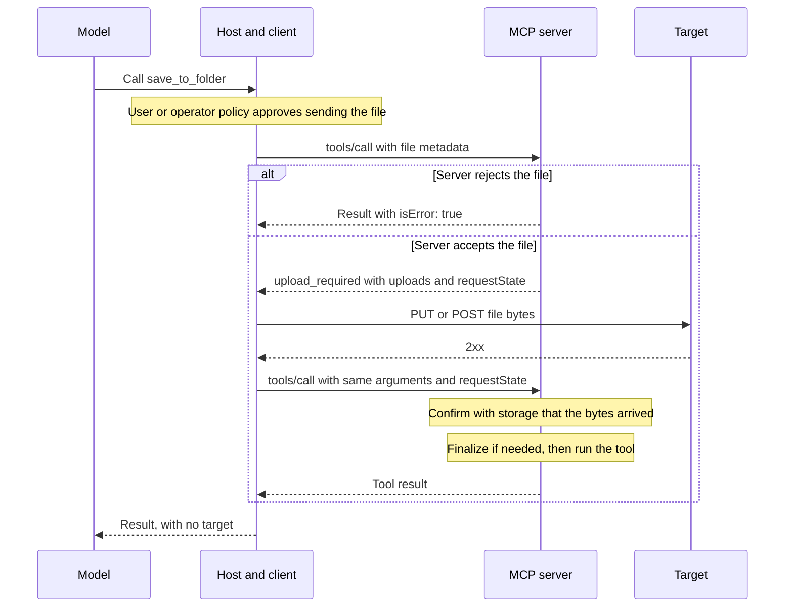
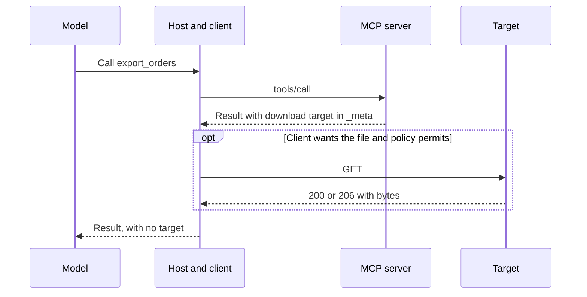

The Model Context Protocol (MCP) started out as a simple way to connect models to tools, and that principle is still very much at its heart. Over the past two years, the things people build with the protocol have become more ambitious. _Much_ more ambitious. Many of those MCP server projects now need to work with files - often driven by increasing agent capabilities and autonomy.


Saving a PDF from a conversation to cloud storage and pulling a CSV into a sandbox have become very common requests from developers adopting MCP. Today, implementing these scenarios would require a bunch of bespoke tool conventions and transfer mechanisms - not something we'd want folks doing over and over.

Because this request kept coming up in customer discussions, we bootstapped the [File Uploads Working Group](https://modelcontextprotocol.io/community/working-groups/file-uploads). We've spent the last month working through what a solution could look like.

Thanks to the effort of our community and developers, we now have a rough extension definition, and we'd love for you to poke at it as we start prototyping and trying out how it works in the wild.



## Where the work stands

The work on the extension is still very much an experimental effort - while we have the shape outlined, we're not sure yet that what we started with is what we'll end up with. The best way to find out is, you guessed it - contact with reality.

You might also notice that there's no reference implementation yet - that's because we expect that a lot of the inner workings will, in fact, be quite different once we start integrating our experiment with third-party file services, such as cloud storage, database import/export, and many others that require file input and output.

As with all other extensions, this one will remain optional - there is no work required on either clients or servers if they don't plan to support it (although we hope they _really_ will, given the broad interest in this work).

We expect to finalize the extension and have it become stable before the end of the year.

## How it works

When we first jumped into discussions for what the extension may be, we had a few key scenarios that guided us:

- You have a large file in a conversation, and you want to save it to cloud storage.
- You want to pull a big CSV file into a code sandbox, so your agent can analyze the data or build some Python code around it.
- You want to upload a large presentation, or an HTML deck with all of its assets in a ZIP file to a third-party remote server.

In each of these scenarios, the agent needs to know a bunch of things about the file, but the model doesn't need to read every byte or even handle it directly. The file should go directly to its destination. This led to the design you will read about below.

The extension identifies itself as `io.modelcontextprotocol/files`, and it works with protocol revision `2026-07-28` and later. A server can advertise it in its `server/discover` response, with `upload` if it accepts files out of band and `maxInlineBytes` if it accepts them inline. A client declares it in the `io.modelcontextprotocol/clientCapabilities` metadata of every request that may need it, including `tools/list`, with `upload` if it can upload out of band and `download` if it accepts download targets.

Let's walk through one simple upload. Let's say a server has a `save_to_folder` tool, and a user wants to save a PDF with it.

### Marking a file argument

The server marks the argument with `x-mcp-file` in the tool's input schema. This is the same pattern as [`x-mcp-header`](https://modelcontextprotocol.io/specification/2026-07-28/server/tools#x-mcp-header), and it tells the client that this argument is a file, so the client fills it in (and, as a result, the model doesn't have to):

```json
{
  "type": "object",
  "properties": {
    "folderId": { "type": "string" },
    "file": {
      "type": "object",
      "x-mcp-file": { "accept": ["application/pdf"], "maxSize": 157286400 },
      "properties": {
        "id": { "type": "string", "minLength": 1, "maxLength": 128 },
        "name": { "type": "string" },
        "mimeType": { "type": "string" },
        "size": { "type": "integer", "minimum": 0 },
        "data": { "type": "string" }
      },
      "required": ["id", "mimeType", "size"]
    }
  },
  "required": ["folderId", "file"]
}
```

A small file can go inline as base64 in `data`, as long as the request's inline files total no more than the `maxInlineBytes` the server advertises. For anything bigger, if the server advertises `upload`, the client leaves `data` out and the upload happens in the steps below. `maxSize` limits each file however it travels. The full `FileInput` shape also has an optional SHA-256 `digest`, which a tool can require in its schema.

A client that doesn't support the extension ignores `x-mcp-file` and treats the argument as an ordinary object. If the client doesn't declare extension support in its `tools/list` request, the server should omit the tool or offer an alternative. For example, that alternative could accept a URL pointing to an already-uploaded file.

### Asking before sending

Before sending the file, the host gets the user's approval. When no user is present, agent policy determines whether the transfer is allowed. The client then calls the tool with just the **file's metadata**, not its contents.


We've left `_meta` out of the request examples to keep them readable. In a real request, that's where the client declares support for the extension.


```json
{
  "jsonrpc": "2.0",
  "id": 1,
  "method": "tools/call",
  "params": {
    "name": "save_to_folder",
    "arguments": {
      "folderId": "fld_8c1a",
      "file": {
        "id": "file-1",
        "name": "Q3 report.pdf",
        "mimeType": "application/pdf",
        "size": 41204133
      }
    }
  }
}
```

Sending metadata first lets the server check permissions and storage quota before the upload starts. If either check fails, the server returns a normal tool error. That way, you don't have to upload 40 MB of data only to discover that the destination folder is read-only.

If the checks pass, the server asks the client to upload the file before it runs the tool. It does this through the extension's new `upload_required` result type. The response tells the client where and how to upload the file, and includes a `requestState` value to send back when retrying the tool call afterward:

```json
{
  "jsonrpc": "2.0",
  "id": 1,
  "result": {
    "resultType": "upload_required",
    "uploads": [
      {
        "fileId": "file-1",
        "url": "https://upload.example.com/u/01JD3V7K2M?sig=...",
        "headers": { "Content-Type": "application/pdf" },
        "credentials": "omit",
        "expiresAt": "2026-11-04T18:30:00Z"
      }
    ],
    "requestState": "..."
  }
}
```

In this example, `requestState` represents the unfinished job: saving the PDF into a specific folder. The server packages the details it needs to continue into a value, protects it against tampering, and sends it with the upload instructions. After uploading the file, the client sends that value back unchanged, without needing to understand its contents.

The next tool call will bring its own context rather than rely on a session with the server. This is intentionally designed with the MCP [stateless core](https://modelcontextprotocol.io/specification/2026-07-28/basic#statelessness) in mind. A different server instance can continue the job too, as long as it can verify the value and access the uploaded file.

In a few scenarios, tools need protection against running twice - for example if another run would create an unwanted duplicate file. For those tools, the server marks `requestState` as used before running the job. All server instances share that record, so another attempt with the same value is rejected.

### Completing the job

The client uploads the PDF to the provided URL using an HTTPS `PUT` request. For storage services that need it, upload targets can instead specify `POST`, including a `multipart/form-data` body. The file's contents will then travel directly to the upload target, outside JSON-RPC.

When the upload succeeds with an HTTP `2xx` response, the client calls our `save_to_folder` tool again. It sends the same arguments and returns `requestState` unchanged, following the newly shipped [Multi Round-Trip Requests](https://modelcontextprotocol.io/specification/2026-07-28/basic/patterns/mrtr) pattern:

```json
{
  "jsonrpc": "2.0",
  "id": 2,
  "method": "tools/call",
  "params": {
    "name": "save_to_folder",
    "arguments": {
      "folderId": "fld_8c1a",
      "file": {
        "id": "file-1",
        "name": "Q3 report.pdf",
        "mimeType": "application/pdf",
        "size": 41204133
      }
    },
    "requestState": "..."
  }
}
```

The server still needs to check the upload, though. It will verify `requestState` and confirm that the retry matches the original call. It will then check with the storage service that the file arrived and validate its size and type.

Only after those checks pass does it run `save_to_folder` and return the result. If the upload fails, the client doesn't send the retry, and the tool doesn't run.

The client coordinates all of this without involving the model again. The model made the tool call and got the result - neither the bytes nor the upload URL entered its context.

If you are curious about the end-to-end flow, it looks something like this:



### Downloading a file

Unsurprisingly, we're also exploring the reverse flow: a tool can produce a file, and the client will need to download it. Like uploads, the file contents travel outside JSON-RPC.

The key difference, however, is that the tool can return download details with its completed result, so the client doesn't need to retry the tool call after the transfer.


An observant reader might notice that upload targets arrive in an `upload_required` result, while download targets appear in `_meta`.

MCP's [`_meta` field](https://modelcontextprotocol.io/specification/2026-07-28/basic#_meta) lets clients and servers attach additional metadata to their interactions, including extension-specific details.

Here, the download instructions accompany the completed tool result rather than going in its normal `content`. Uploads need a different signal: `upload_required` tells the client to upload and retry before the tool can run. The extension keeps both kinds of targets out of model context.


The draft defines a download response format using the result's `_meta`. In the CSV example below, the tool returns the download URL and file details, and the client can fetch the file with an HTTPS `GET` request:

```json
{
  "jsonrpc": "2.0",
  "id": 3,
  "result": {
    "resultType": "complete",
    "content": [{ "type": "text", "text": "Exported q3-orders.csv." }],
    "_meta": {
      "io.modelcontextprotocol/files": {
        "downloads": [
          {
            "name": "q3-orders.csv",
            "mimeType": "text/csv",
            "size": 209715200,
            "url": "https://download.example.com/d/01JD3V9P4Q?sig=...",
            "credentials": "omit",
            "expiresAt": "2026-11-04T18:30:00Z"
          }
        ]
      }
    }
  }
}
```

How download details should be represented in tool results is still an [open design question](https://github.com/modelcontextprotocol/experimental-ext-file-uploads/blob/main/specification/draft/file-uploads.md#open-questions). While we're currently using `_meta`, we'd very much like feedback on how this approach works in practice.

The client declares `download` support in its tool call to tell the server it knows how to handle download targets. Only then can the server include them in its response. The result's `content` still tells the model what was produced, such as "Exported q3-orders.csv.", while the client handles the download target without exposing it to the model.

After downloading, the client checks the file's byte count against `size`. If the server supplied a `digest`, the client also calculates the file's hash and compares it with that value. A mismatch means the file must be discarded.


It's worth noting that a matching `digest` confirms that the bytes match the supplied hash, not that the file is safe. A server can provide a harmful file and a matching digest - clients must still treat downloaded files as untrusted.


This is what the proposed file download flow looks like:



## What about credentials

A file transfer may go to a storage service rather than the MCP server itself. This means that the client must not automatically send its MCP credentials to every URL the server provides, because that could expose the token to a completely unrelated service.

Every upload and download target therefore includes a `credentials` field. It tells the client whether to attach the credential it uses for the MCP server, with two modes: `omit` and `include`.

With `"credentials": "omit"`, used in the examples above, the client doesn't attach its MCP token, cookies, or other credentials from its environment. The target provides its own authorization, such as the signature in a pre-signed URL. That lets the storage service accept the transfer without receiving the client's MCP credential.

With `"credentials": "include"`, the client attaches its MCP credential, but **only** to a `path` under its MCP address or a URL on the server's own origin. This is useful when pre-signed URLs aren't an option or file transfers need to pass through a gateway.

In the example below, the server provides a `path` instead of a separate URL when uploading a file:

```json
{
  "fileId": "file-1",
  "path": "/uploads",
  "credentials": "include"
}
```

For a client using `https://gateway.example.com/mcp/abc`, that `path` resolves to `https://gateway.example.com/mcp/abc/uploads`. The upload goes through the same gateway as the MCP calls and uses the same MCP credential. This also helps sandboxed clients that can reach the gateway but not the storage service directly.

The client must also refuse redirects and reject targets that supply an `Authorization` header. This helps prevent scenarios where a target redirects the transfer to another origin or overrides the credential handling defined by `credentials`.

These safeguards control where the client's MCP credential is sent, but they don't by themselves control **where the file goes**. With `omit`, a malicious server could still direct an upload to a public endpoint it controls. The host gets approval before it knows the target, so that approval doesn't cover the specific destination.

To limit the risk, our draft recommends that hosts restrict `omit` targets to an allowlist of permitted origins. Whether that restriction should be mandatory is another [open question](https://github.com/modelcontextprotocol/experimental-ext-file-uploads/blob/main/specification/draft/file-uploads.md#open-questions) that we'd love your thoughts on.

The draft's [Security Implications](https://github.com/modelcontextprotocol/experimental-ext-file-uploads/blob/main/specification/draft/file-uploads.md#security-implications) section discusses these risks in more detail, along with our thinking on how to mitigate them.

## We'd love your help

We'd love your feedback on the [draft](https://github.com/modelcontextprotocol/experimental-ext-file-uploads/blob/main/specification/draft/file-uploads.md). You can explore the [extension repository](https://github.com/modelcontextprotocol/experimental-ext-file-uploads), [open an issue](https://github.com/modelcontextprotocol/experimental-ext-file-uploads/issues), or come chat with us in the [working group's Discord discussion](https://discord.com/channels/1358869848138059966/1497669234564661438). See our [communications guide](https://modelcontextprotocol.io/community/communication) for details on joining the community.

## Acknowledgments

Thanks to Ethan Heimlich, Gaurav Soni, [Jay Zuccarelli](https://github.com/jayzuccarelli), [Kevin Lam](https://github.com/kevklam), [Kryspin Ziemski](https://github.com/kziemski), [Kurtis Van Gent](https://github.com/kurtisvg), Madhavi Pasumarthi, Mike Coopersmith, [Mike Eastes](https://github.com/meastes), [Patrick Rodgers](https://github.com/patrick-rodgers), Prem Ramanathan, [Thomas Sarlandie](https://github.com/tsarlandie-oai), and everyone who has brought use cases, questions, and feedback to the [working group's discussions](https://github.com/modelcontextprotocol/modelcontextprotocol/discussions?discussions_q=Files+Working+Group+Meeting+in%3Atitle).
