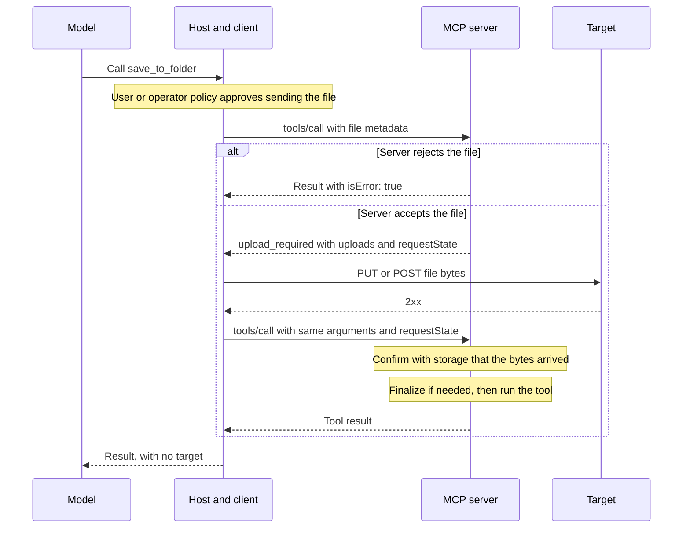
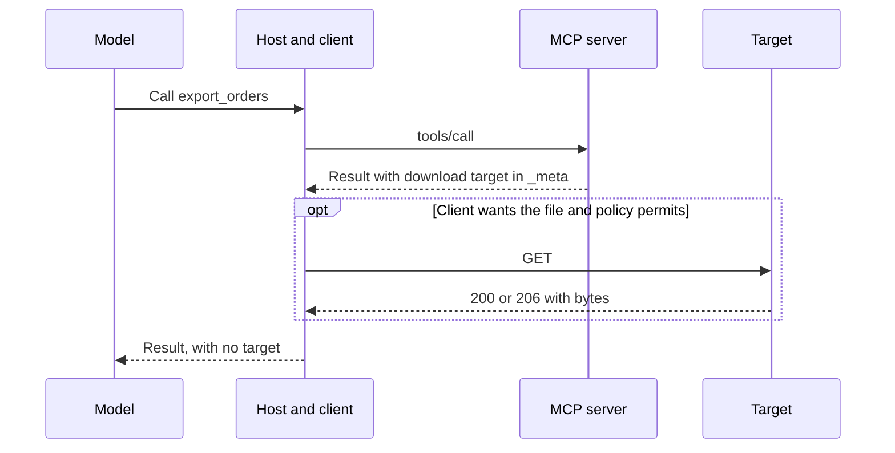

The Model Context Protocol (MCP) started out as a way to connect models to tools, and that's still the heart of it. But the things people build with it keep getting more ambitious, and sooner or later a lot of those projects need to work with files. Saving a PDF out of a conversation. Pulling a CSV into a sandbox. Handing a tool a deck with a pile of assets.

This came up enough that we spun up the [File Uploads Working Group](https://modelcontextprotocol.io/community/working-groups/file-uploads), and we've spent the last month trying out what a solution could look like. We now have a rough extension, and we'd love for you to poke at it as we start prototyping.



## Where this stands

This is an experimental effort, and we're not sure yet that the shapes we started with are the ones we'll end up with. The best way to find out is contact with reality. So we'd love for you to try it out, and maybe help us prototype it, so we can all see what works and what doesn't.

It hasn't been approved, it's not part of the MCP specification, and it may change a lot. It's an optional extension, so tools that don't adopt it keep working the way they do today.

## What we had in mind

We started with a few scenarios:

- You have a large file in a conversation, and you want to save it to cloud storage.
- You want to pull a big CSV file into a code sandbox, so your agent can analyze the data or build some Python code around it.
- You want to upload a large presentation, or an HTML deck with all of its assets in a zip file.

The agent needs to know about the file in each of these, but the model doesn't need to read every byte of it. The file should go straight to where it's going, and the model should just hear how it went.

## How it works

Let's walk through one upload. Say a server has a `save_to_folder` tool, and a user wants to save a PDF with it.

### Marking a file argument

The server marks the argument with `x-mcp-file` in the tool's input schema. This is the same pattern as [`x-mcp-header`](https://modelcontextprotocol.io/specification/draft/server/tools#x-mcp-header), and it tells the client that this argument is a file, so the client fills it in and the model doesn't have to:

```json
"file": {
  "type": "object",
  "x-mcp-file": { "accept": ["application/pdf"], "maxSize": 157286400 },
  "properties": {
    "id": { "type": "string" },
    "name": { "type": "string" },
    "mimeType": { "type": "string" },
    "size": { "type": "integer", "minimum": 0 },
    "data": { "type": "string" }
  },
  "required": ["id", "mimeType", "size"]
}
```

A small file can go inline as base64 in `data`, as long as the request's inline files total no more than the `maxInlineBytes` the server advertises. For anything bigger, the client leaves `data` out and the upload happens in the steps below.

### Asking before sending

Once the host has the user's approval to send the file, the client calls the tool with the file's metadata and no bytes. We've left the `_meta` fields out of these examples:

```json
{
  "jsonrpc": "2.0",
  "id": 1,
  "method": "tools/call",
  "params": {
    "name": "save_to_folder",
    "arguments": {
      "folderId": "fld_8c1a",
      "file": {
        "id": "file-1",
        "name": "Q3 report.pdf",
        "mimeType": "application/pdf",
        "size": 41204133
      }
    }
  }
}
```

We send metadata first so the server can say no cheaply. It sees the destination folder along with the file, so it can check permissions and quota, and return a normal tool error if something's off. Nobody uploads 40 MB only to find out the folder is read-only.

If the server is fine with the file, it responds with an upload target, using a new `upload_required` result type that the extension adds:

```json
{
  "jsonrpc": "2.0",
  "id": 1,
  "result": {
    "resultType": "upload_required",
    "uploads": [
      {
        "fileId": "file-1",
        "url": "https://upload.example.com/u/01JD3V7K2M?sig=...",
        "headers": { "Content-Type": "application/pdf" },
        "credentials": "omit",
        "expiresAt": "2026-11-04T18:30:00Z"
      }
    ],
    "requestState": "..."
  }
}
```

The `requestState` is opaque to the client, and it's how the server avoids keeping protocol session state. The server binds the tool name, the arguments, the target, and the authenticated user into it, so any instance that can reach the storage can handle the next step.

### Moving the bytes and finishing the call

The client sends the file to the target with an ordinary HTTPS request, here a `PUT`. Targets can also use `POST` or a multipart form, because that's what a lot of storage APIs expect. The bytes never touch a JSON-RPC message.

Once it gets a `2xx`, the client retries the tool call with the same arguments and the `requestState` it was given:

```json
{
  "jsonrpc": "2.0",
  "id": 2,
  "method": "tools/call",
  "params": {
    "name": "save_to_folder",
    "arguments": {
      "folderId": "fld_8c1a",
      "file": {
        "id": "file-1",
        "name": "Q3 report.pdf",
        "mimeType": "application/pdf",
        "size": 41204133
      }
    },
    "requestState": "..."
  }
}
```

The server checks with the storage that the bytes arrived, runs the tool, and returns an ordinary tool result. If a transfer fails, the client doesn't retry the call, and the tool doesn't run.

All of this happens inside the client. The model made one tool call and got one result, and neither the bytes nor the upload URL entered its context.

Here's the whole upload:



### Getting a file back

Downloads are simpler. A tool lists the file in the `_meta` of its result, and the client fetches it with a `GET`:

```json
{
  "jsonrpc": "2.0",
  "id": 3,
  "result": {
    "resultType": "complete",
    "content": [{ "type": "text", "text": "Exported q3-orders.csv." }],
    "_meta": {
      "io.modelcontextprotocol/files": {
        "downloads": [
          {
            "name": "q3-orders.csv",
            "mimeType": "text/csv",
            "size": 209715200,
            "url": "https://download.example.com/d/01JD3V9P4Q?sig=...",
            "credentials": "omit",
            "expiresAt": "2026-11-04T18:30:00Z"
          }
        ]
      }
    }
  }
}
```

And here's the whole download:



## Who gets to see your credentials

Every target has a `credentials` field, and it tells the client whether to attach the credential it uses for this MCP server.

We need that field because the server picks the target. If a client attached its token to any URL a server handed it, a server could point it at another host and collect the token. So the client attaches it only when the server asks and the target is somewhere that credential already goes.

The first case is `"credentials": "omit"`, which is what you saw above. The URL carries its own authorization, like a pre-signed URL from an object store. The client sends the file with no token, cookie, or other credential, so a third-party storage host never sees anything that works against your MCP server.

The second case is for deployments that don't allow pre-signed URLs, or where a gateway sits between the client and the storage and holds the OAuth credentials. There the server issues a `path` and asks for the credential:

```json
{
  "fileId": "file-1",
  "path": "/uploads",
  "credentials": "include"
}
```

The client resolves that `path` under the MCP address it already uses, so with `https://gateway.example.com/mcp/abc`, the file goes to `https://gateway.example.com/mcp/abc/uploads`. The bytes take the same route as the client's MCP calls, which also helps a client in a sandbox that can't reach a public storage host at all. The client attaches its MCP credential here because it's going where that credential already goes. `include` also works on a `url` with the same origin as the server, and the client rejects it on any other `url`.

A target can't set its own `Authorization` header, and the client won't follow redirects, so the token can't leave the server's origin.

## We'd love your help

Try this against something real. Read the draft, point it at the storage or the agent you work with, and tell us what happens. If you're up for building a prototype, even better.

You can [open an issue](https://github.com/modelcontextprotocol/experimental-ext-file-uploads/issues) in the extension repository, or come talk to us in the working group's thread on the [MCP Discord](https://modelcontextprotocol.io/community/communication#discord).
