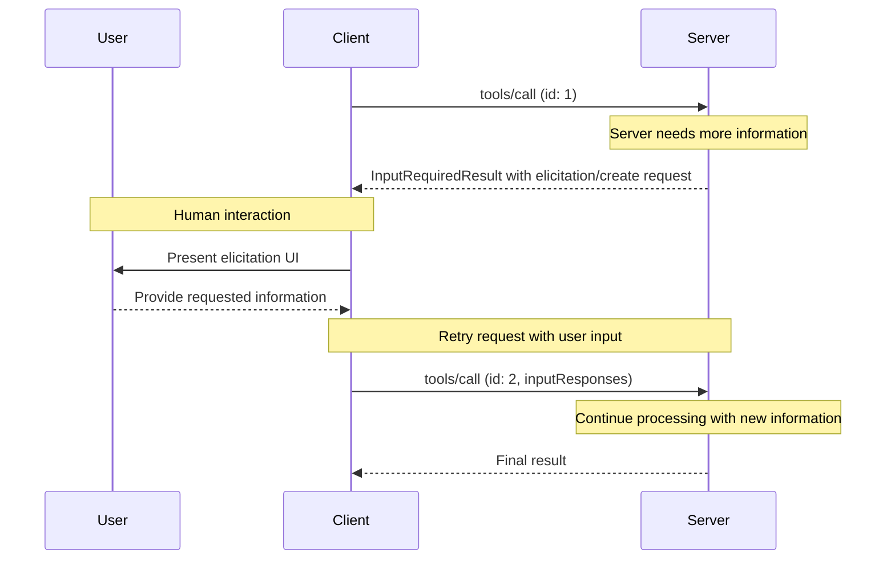

MCP clients are instantiated by host applications to communicate with particular MCP servers. The host application, like Claude.ai or an IDE, manages the overall user experience and coordinates multiple clients. Each client handles one direct communication with one server.

Understanding the distinction is important: the _host_ is the application users interact with, while _clients_ are the protocol-level components that enable server connections.

## Core Client Features

In addition to making use of context provided by servers, clients can provide features to servers, such as [elicitation](/specification/draft/client/elicitation). These allow server authors to build richer interactions.

### Elicitation

Elicitation enables servers to request specific information from users during interactions, creating more dynamic and responsive workflows. For example, a server booking travel may ask for the user's preferences on airplane seats, room type or their contact number to finalize a booking.

#### Overview

Elicitation provides a structured way for servers to gather necessary information on demand. Instead of requiring all information up front or failing when data is missing, servers can pause their operations to request specific inputs from users. This creates more flexible interactions where servers adapt to user needs rather than following rigid patterns.

Elicitation supports two modes:

- **Form mode**: The server asks the client to collect structured data from the user. The request includes a schema that the client uses to build an input form and validate the response.
- **URL mode**: The server provides a URL for the user to open. The interaction happens out of band and its data never passes through the client, which makes this mode suitable for sensitive flows such as credential entry or third-party OAuth authorization.

Elicitation follows the [Multi Round-Trip Requests](/specification/draft/basic/patterns/mrtr) (MRTR) pattern. When a server needs user input while processing a request such as `tools/call`, it responds with an `InputRequiredResult` whose `inputRequests` field carries one or more `elicitation/create` requests. The client gathers the input and retries the original request, attaching the collected `inputResponses` and echoing back any `requestState` the server included.

Clients declare the modes they support in the `elicitation` capability of each request, and servers must not use any other mode. An empty object (`{}`) declares form mode only, while `{ "form": {}, "url": {} }` declares both.

**Elicitation flow:**



The flow enables dynamic information gathering. Servers can request specific data when needed, users provide information through appropriate UI, and servers complete the retried request with the newly acquired context.

**Elicitation example:**

The following messages continue building on the [travel planning scenario](/docs/draft/learn/server-concepts#the-complete-flow). The client calls the `bookVacation` tool:

```json
{
  "jsonrpc": "2.0",
  "id": 1,
  "method": "tools/call",
  "params": {
    "name": "bookVacation",
    "arguments": {
      "outboundFlight": "EX101",
      "returnFlight": "EX102",
      "hotelId": "beachfront-hotel"
    },
    "_meta": {
      "io.modelcontextprotocol/protocolVersion": "2026-07-28",
      "io.modelcontextprotocol/clientInfo": {
        "name": "example-client",
        "version": "1.0.0"
      },
      "io.modelcontextprotocol/clientCapabilities": {
        "elicitation": {}
      }
    }
  }
}
```

The server needs the user to confirm the booking, so it responds with an `InputRequiredResult`. Its `resultType` of `"input_required"` indicates that the client must provide additional input before the server can complete the request:

```json
{
  "jsonrpc": "2.0",
  "id": 1,
  "result": {
    "resultType": "input_required",
    "inputRequests": {
      "bookingConfirmation": {
        "method": "elicitation/create",
        "params": {
          "mode": "form",
          "message": "Please confirm your Barcelona vacation booking: flights June 15-22, beachfront hotel, total $3,000.",
          "requestedSchema": {
            "type": "object",
            "properties": {
              "confirmBooking": {
                "type": "boolean",
                "description": "Confirm the booking (Flights + Hotel = $3,000)"
              },
              "seatPreference": {
                "type": "string",
                "enum": ["window", "aisle", "no preference"],
                "description": "Preferred seat type for flights"
              },
              "roomType": {
                "type": "string",
                "enum": ["sea view", "city view", "garden view"],
                "description": "Preferred room type at hotel"
              },
              "travelInsurance": {
                "type": "boolean",
                "default": false,
                "description": "Add travel insurance ($150)"
              }
            },
            "required": ["confirmBooking"]
          }
        }
      }
    },
    "requestState": "opaque-string-from-the-server",
    "_meta": {
      "io.modelcontextprotocol/serverInfo": {
        "name": "travel-server",
        "version": "1.0.0"
      }
    }
  }
}
```

After the user fills in the form, the client retries the call with a new `id`. The retry carries the user's answers in `inputResponses`, under the same `bookingConfirmation` key as the server's request, and the exact `requestState` value from the result:

```json
{
  "jsonrpc": "2.0",
  "id": 2,
  "method": "tools/call",
  "params": {
    "name": "bookVacation",
    "arguments": {
      "outboundFlight": "EX101",
      "returnFlight": "EX102",
      "hotelId": "beachfront-hotel"
    },
    "inputResponses": {
      "bookingConfirmation": {
        "action": "accept",
        "content": {
          "confirmBooking": true,
          "seatPreference": "window",
          "roomType": "sea view",
          "travelInsurance": false
        }
      }
    },
    "requestState": "opaque-string-from-the-server",
    "_meta": {
      "io.modelcontextprotocol/protocolVersion": "2026-07-28",
      "io.modelcontextprotocol/clientInfo": {
        "name": "example-client",
        "version": "1.0.0"
      },
      "io.modelcontextprotocol/clientCapabilities": {
        "elicitation": {}
      }
    }
  }
}
```

The server completes the booking and returns a `CallToolResult`. Its `resultType` of `"complete"` indicates that the request completed successfully:

```json
{
  "jsonrpc": "2.0",
  "id": 2,
  "result": {
    "resultType": "complete",
    "content": [
      {
        "type": "text",
        "text": "Booked flights EX101 and EX102 and a sea view room at the beachfront hotel."
      }
    ],
    "_meta": {
      "io.modelcontextprotocol/serverInfo": {
        "name": "travel-server",
        "version": "1.0.0"
      }
    }
  }
}
```

#### Example: Holiday Booking Approval

A travel booking server demonstrates elicitation's power through the final booking confirmation process. When a user has selected their ideal vacation package to Barcelona, the server needs to gather final approval and any missing details before proceeding.

The server elicits booking confirmation with a structured request that includes the trip summary (Barcelona flights June 15-22, beachfront hotel, total $3,000) and fields for any additional preferences—such as seat selection, room type, or travel insurance options.

As the booking progresses, the server elicits contact information needed to complete the reservation. It might ask for traveler details for flight bookings, special requests for the hotel, or emergency contact information.

#### User Interaction Model

Elicitation interactions are designed to be clear, contextual, and respectful of user autonomy:

**Request presentation**: Clients display elicitation requests with clear context about which server is asking, why the information is needed, and how it will be used. The request message explains the purpose while the schema provides structure and validation.

**Response options**: Users can provide the requested information through appropriate UI controls (text fields, dropdowns, checkboxes), explicitly decline to provide it, or dismiss the request without making a choice. These map to the `accept`, `decline`, and `cancel` actions. Clients validate responses against the provided schema before returning them to servers.

**URL handling**: For URL mode, clients show the full URL and gather explicit consent before opening it, and never fetch the URL automatically. The client only learns whether the user consented. The interaction itself stays between the user and the target site.

**Privacy considerations**: Servers must not use form mode to request sensitive information such as passwords, API keys, access tokens, or payment credentials. Those interactions belong in URL mode, which keeps the data out of band so it never passes through the client or the LLM context. Clients warn about suspicious requests and let users review form data before sending.

## Deprecated Features

<Warning>

Roots and sampling are [deprecated](/specification/draft/deprecated) as of protocol version `2026-07-28` and scheduled for removal. New implementations should use the following alternatives:

- **Roots**: Pass directories or files through tool parameters, resource URIs, or server configuration.
- **Sampling**: Integrate directly with LLM provider APIs.

</Warning>
