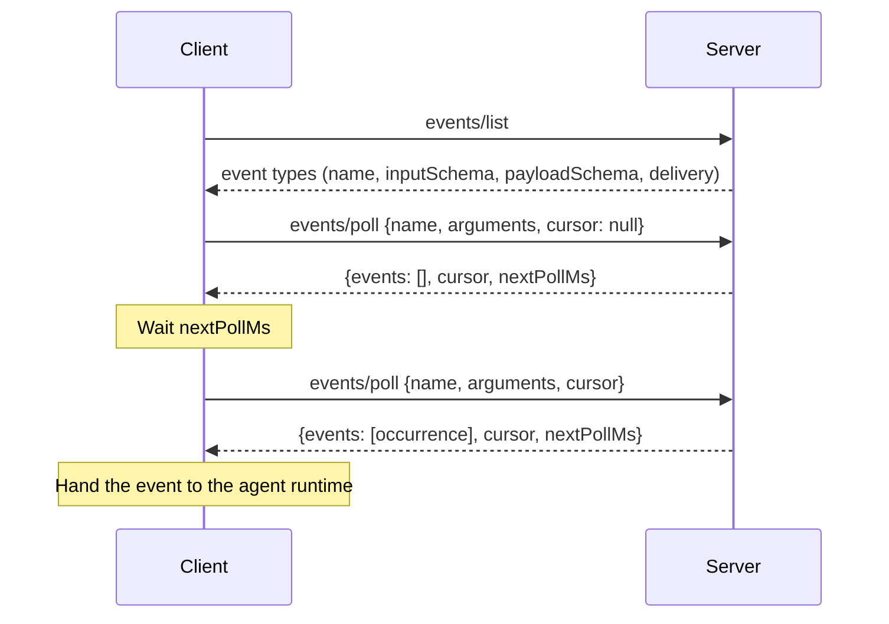

The [ext-events repository](https://github.com/modelcontextprotocol/ext-events)
contains the full specification for the official Events extension
(`io.modelcontextprotocol/events`). [SEP-3415](/seps/3415-events-extension) is
Final, and the extension is in Beta. The
[Tasks and Events Working Group](/community/working-groups/tasks-events)
maintains it.

<Card
  title="modelcontextprotocol/ext-events"
  icon="github"
  href="https://github.com/modelcontextprotocol/ext-events"
>
  Full specification and documentation for MCP Events.
</Card>

MCP is request-driven: a user or a model asks, and a server answers. Agents
increasingly need to act on things that happen when nobody is asking, such as a
new email, a push to a repository or a production incident. MCP Events lets a
client subscribe to these upstream events, with arguments, and have an agent
react when they occur, even when no user is present.

## Why not existing notifications?

MCP already has notifications such as `notifications/resources/updated` and the
`list_changed` family. They don't cover this use case:

- **No parameters or payload.** A notification says that a URI or a list
  changed. It can't express "a P1 incident was created for service X", because
  there are no subscription arguments, no payload schema and no payload.
- **A live connection is required.** Notifications arrive only on an open
  `subscriptions/listen` stream. A client that isn't connected receives nothing.
- **No resumption.** There is no cursor, so anything that happens during a
  disconnect is lost, and the client can't tell that it missed anything.

The deployments that need events also differ. A serverless server can't hold a
connection per subscriber, a client behind NAT can't receive a callback, and a
cost-sensitive client shouldn't poll. That's why Events defines three delivery
modes, and a server picks the ones that fit each event type.

## How Events work

1. **Capability negotiation.** The server advertises
   `io.modelcontextprotocol/events` in its `server/discover` capabilities. The
   client may declare the same identifier in its per-request capabilities.

2. **Discovery.** The client calls `events/list`. Each event type has a `name`,
   an `inputSchema` for subscription arguments, a `payloadSchema` for the data
   it delivers, and the `delivery` modes it supports.

3. **Subscription.** The client subscribes with an event name and arguments,
   using one of the modes the event type lists. A `null` cursor means "start
   from now".

4. **Delivery.** Each event arrives as an occurrence:
   `{eventId, name, timestamp, data, cursor}`. The client stores the cursor
   after each delivery.

5. **Resumption.** After a disconnect or a restart, the client resubscribes
   with its stored cursor. If the server can't serve from that position, it
   says so with `truncated: true`, so the client knows that events were skipped.

6. **Reaction.** The client SDK hands each event to the agent runtime, which
   decides how to react, for example by starting a new agent turn.



## Delivery modes

None of the three modes is mandatory. An event type lists any non-empty subset
of them, and the client SDK picks one it can use.

| Mode        | Method             | How it works                                                                                                  | Good fit for                                         |
| ----------- | ------------------ | ------------------------------------------------------------------------------------------------------------- | ---------------------------------------------------- |
| **Poll**    | `events/poll`      | The client asks for new events at the interval the server recommends. The server holds no per-client state.   | Stateless and serverless servers, simple clients     |
| **Push**    | `events/stream`    | The client holds a long-lived request open, and the server delivers events on it as notifications.            | Local (stdio) servers, clients that stay connected   |
| **Webhook** | `events/subscribe` | The client registers an `https` callback URL, and the server POSTs signed events to it under a renewable TTL. | Remote servers, clients that can't hold a connection |

SDKs typically prefer webhook when the client has a callback endpoint, then
push, then poll. A client can override the choice per subscription.

## When to use Events

Events are a good fit when your use case involves:

**Reacting to upstream activity.** New messages, repository pushes, payments,
incidents or calendar changes that an agent should act on.

**Unattended agents.** Background agents that run when no user is present and
need to be woken by something happening.

**Filtered streams.** Subscriptions that narrow a large stream with arguments,
such as "P1 incidents for service X" or "email from this sender".

If the client is waiting for the result of a long-running operation it started
itself, use [Tasks](/extensions/tasks/overview) instead.

## Cursors and delivery guarantees

Cursors are opaque, server-defined positions in the event stream. They make
delivery at-least-once when the upstream is durable and the client resumes from
its last cursor.

- **Replay is optional per event type.** A server returns `cursor: null` for an
  event type that has no addressable history. The client then always starts
  from now, and accepts that events during a gap can't be recovered.
- **Bounded replay.** A client can pass `maxAgeMs` with a stale cursor, so that
  a host that was offline for a week gets at most, say, the last five minutes.
- **Deduplication.** `eventId` is stable for an upstream event, so a client can
  discard duplicates within a subscription.
- **Ordering.** Poll and push deliver events in order within a subscription.
  Webhook ordering is best-effort, and the `timestamp` field orders events.

The client owns its list of subscriptions. There is no server method that lists
them, and the client can rebuild server-side state at any time.

## Security model

- **Payloads are untrusted data.** Event payloads come from external systems
  and can carry prompt injection. Treat them like tool results, and sanitize or
  sandbox them before they reach a model.
- **Minimal payloads.** Servers should send enough to identify and triage an
  event, such as a sender, subject and ID, and let the client fetch full content
  with tools.
- **Authorization at every step.** The server checks permission at subscribe
  time, re-checks at delivery time, and terminates the subscription if access is
  revoked. Receiving an event never authorizes the agent to act: its follow-up
  tool calls go through normal MCP authorization.
- **Webhook hardening.** Deliveries are signed with
  [Standard Webhooks](https://www.standardwebhooks.com/) HMAC signatures.
  Callback URLs must be `https`, the server verifies an endpoint before it
  delivers to it, and it validates destination IPs to prevent SSRF.

## Implementation guide

### For MCP clients

<Steps>
<Step title="Declare support">

Include the extension in the per-request capabilities you send:

```jsonc
{
  "params": {
    // Other fields...
    "_meta": {
      "io.modelcontextprotocol/clientCapabilities": {
        "extensions": {
          "io.modelcontextprotocol/events": {},
        },
      },
    },
  },
}
```

Don't send `events/*` requests to a server that hasn't advertised the extension.

</Step>
<Step title="Discover and subscribe">

Call `events/list`, validate subscription arguments against each event type's
`inputSchema`, and pick a delivery mode from its `delivery` list.

</Step>
<Step title="Persist cursors">

Store the latest cursor for each subscription durably, and resume from it after
a restart. Treat `truncated: true` as a possible gap, and re-read authoritative
state with tools if it matters.

</Step>
<Step title="Deliver events safely">

Deduplicate by `eventId`, and treat payloads as untrusted before passing them
to a model.

</Step>
</Steps>

### For MCP servers

<Steps>
<Step title="Advertise support">

Include the extension in your `server/discover` capabilities. Set `listChanged`
if you send `notifications/events/list_changed`:

```jsonc
{
  "result": {
    // Other fields...
    "capabilities": {
      "extensions": {
        "io.modelcontextprotocol/events": {
          "listChanged": true,
        },
      },
    },
  },
}
```

</Step>
<Step title="Describe event types">

Return each event type from `events/list` with its `inputSchema`,
`payloadSchema` and supported `delivery` modes. Evolve schemas additively, and
publish a breaking change under a new event name.

</Step>
<Step title="Use upstream identifiers">

Use the upstream system's stable event ID as `eventId`, and encode the upstream
position in the cursor, so that clients can resume and deduplicate.

</Step>
<Step title="Check authorization">

Verify that the principal may subscribe with the given arguments, and terminate
subscriptions when access is revoked.

</Step>
</Steps>

## Client support

<Note>

MCP Events is an extension to the [core MCP specification](/specification/latest).
It requires protocol revision `2026-07-28` or later.

</Note>

See the [client matrix](/extensions/client-matrix) for extension support across
clients. Events requires explicit opt-in from both client and server.

## Specification

The Events extension is specified in the
[ext-events repository](https://github.com/modelcontextprotocol/ext-events). It
uses the standard MCP [extension negotiation](/extensions/overview#negotiation)
mechanism. For the design rationale, see
[SEP-3415](/seps/3415-events-extension).
