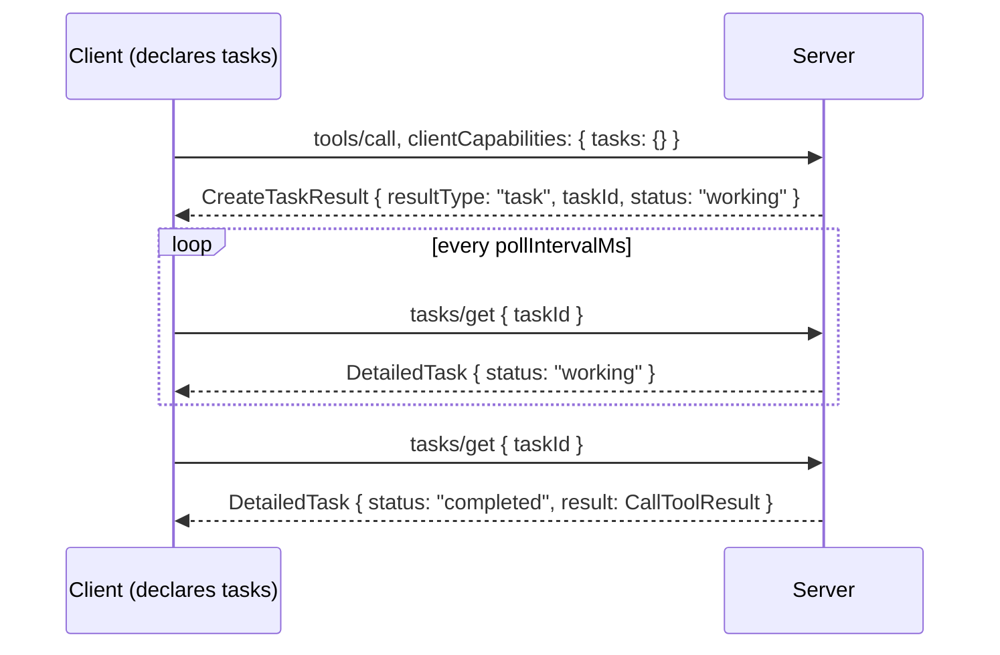
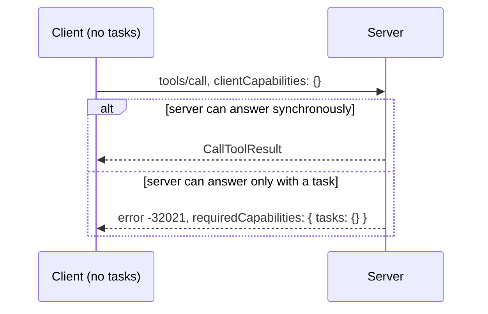
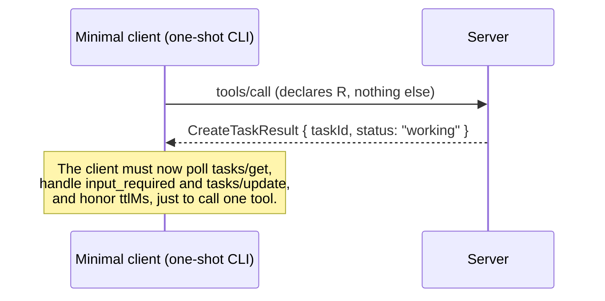

<div className="flex items-center gap-2 mb-4">
  <Badge color="gray" shape="pill">
    Draft
  </Badge>
  <Badge color="gray" shape="pill">
    Standards Track
  </Badge>
</div>

| Field         | Value                                                                           |
| ------------- | ------------------------------------------------------------------------------- |
| **SEP**       | 3569                                                                            |
| **Title**     | Promote Tasks into the Core Protocol                                            |
| **Status**    | Draft                                                                           |
| **Type**      | Standards Track                                                                 |
| **Created**   | 2026-11-19                                                                      |
| **Author(s)** | Sri Panyam ([@panyam](https://github.com/panyam))                               |
| **Sponsor**   | None                                                                            |
| **PR**        | [#3569](https://github.com/modelcontextprotocol/modelcontextprotocol/pull/3569) |

---

## Abstract

This SEP promotes the Tasks extension (`io.modelcontextprotocol/tasks`, [SEP-2663](./2663-tasks-extension.md)) into the core protocol. It follows the promotion rules in [SEP-3392](./3392-extension-lifecycle.md).

With tasks, a server can answer a request with a durable handle instead of a result. The client polls the handle with `tasks/get`. It answers mid-flight input with `tasks/update`, and it stops the work with `tasks/cancel`.

SEP-2663 moved tasks out of the `2025-11-25` core specification and into an extension. The design could then change with implementation feedback. The extension is now Beta, and its stated destination is Core.

This SEP names the core protocol revision R in which tasks becomes core behavior. It defines every difference between core tasks and the extension's final revision, as SEP-3392 requires. A request that declares a revision earlier than R keeps the extension's behavior.

## Motivation

SEP-2663 stated the goal: "Once the extension has stabilized and achieved broad adoption, it is intended to be promoted into the core protocol." The Tasks and Events Working Group carries this goal as its work item "Tasks stabilization and core protocol promotion".

> TODO: adoption evidence. Clients that support tasks (client matrix, PRs #3355 and #3459). SDKs that implement the extension (TypeScript `@modelcontextprotocol/ext-tasks`, mcpkit, others). Conformance results.

> TODO: proposals that build on tasks. SEP-2848 (asynchronous tool approval) and SEP-2694 (resumable task event streams) depend on tasks. ext-tasks PR #38 binds task output to Events (SEP-3415). Today each of them depends on an extension. After promotion they depend on core.

> TODO: SDK cost. SDKs ship tasks as a separate package today. Core tasks removes the per-request extension declaration and the separate package.

## Specification

### Source and target revision

The extension's source is [`modelcontextprotocol/ext-tasks`](https://github.com/modelcontextprotocol/ext-tasks), revision `2026-07-28`, at `specification/2026-07-28/`. Under SEP-3392 that directory moves to `specification/beta/tasks/2026-07-28/`.

> TODO: target revision R. Under SEP-3398 a release-bound SEP must be Final and merged by soft freeze.

Core tasks is the extension's `2026-07-28` revision, with the differences listed below. A behavior this section does not list is unchanged from the extension.

### Differences from the extension

#### D1. Capability negotiation

Under the extension, the client declares `io.modelcontextprotocol/tasks` under `extensions` in each request's `io.modelcontextprotocol/clientCapabilities`. The server lists the same identifier under `extensions` in its `server/discover` result. Under R, tasks becomes a core capability named `tasks`. The client still opts in on each request. The rules are otherwise unchanged.

**Client.** A client that can handle a `CreateTaskResult` declares `tasks` in `io.modelcontextprotocol/clientCapabilities` on each request where it accepts one:

```json
{
  "jsonrpc": "2.0",
  "id": 1,
  "method": "tools/call",
  "params": {
    "name": "build_report",
    "arguments": { "quarter": "Q3" },
    "_meta": {
      "io.modelcontextprotocol/protocolVersion": "R",
      "io.modelcontextprotocol/clientCapabilities": {
        "tasks": {}
      }
    }
  }
}
```

**Server.** A server that can return tasks SHOULD advertise `tasks` in its `server/discover` result:

```json
{
  "capabilities": {
    "tools": {},
    "tasks": {}
  }
}
```

An empty object means support with no settings. Later revisions MAY define settings.

**Rules.**

- A server **MUST NOT** return a `CreateTaskResult` for a request that does not declare `tasks`.
- If the server can serve such a request only by creating a task, it **MUST** return `MissingRequiredClientCapabilityError` (`-32021`) with `data.requiredCapabilities` set to `{ "tasks": {} }`.
- A client that declares `tasks` **MUST** accept either the ordinary result or a `CreateTaskResult` for any task-augmented request.
- `tasks/get`, `tasks/update`, `tasks/cancel` and a `subscriptions/listen` request that names `taskIds` **MUST** declare `tasks`. A server returns `-32021` for one that does not.

> TODO: confirm the last rule against the extension text. The extension specifies `-32021` for `subscriptions/listen` without the declaration. Check what it specifies for `tasks/*`.

The two diagrams show a declaring client and a non-declaring client.





#### D2. Relationship to the `2025-11-25` tasks feature

The `2025-11-25` revision defined an experimental feature named tasks. That feature advertised `capabilities.tasks` during `initialize`, with sub-keys such as `tasks.requests.tools.call`. It had a `task` request parameter, a blocking `tasks/result` and `tasks/list`. The `2026-07-28` revision removed it from core.

Core tasks under R reuses the name `tasks` for the capability key and the `tasks/` method prefix. It does not reuse the `2025-11-25` semantics. The negotiated protocol version decides which definition applies:

| Request declares | Capability location                                                  | Definition                             |
| ---------------- | -------------------------------------------------------------------- | -------------------------------------- |
| `2025-11-25`     | `capabilities.tasks` in `initialize`                                 | `2025-11-25` experimental tasks        |
| `2026-07-28`     | `extensions["io.modelcontextprotocol/tasks"]`                        | Tasks extension, revision `2026-07-28` |
| R or later       | `tasks` in per-request `clientCapabilities` and in `server/discover` | This SEP                               |

> TODO: SEP-2596 lifecycle wording for the `2025-11-25` feature, and a note in `deprecated.mdx` or the changelog.

#### D3. Reserved names and error codes

> TODO: the core reservations for the `tasks/` method prefix, the `notifications/tasks/` prefix, the `resultType` value `"task"`, and error `-32021` for tasks.

#### D4. Task-augmented requests

> TODO: whether `tools/call` stays the only task-augmented request. See Open Question 4.

#### D5. Input requests

> TODO: which server-to-client requests `inputRequests` may carry under R, given the deprecation of sampling in SEP-2577. See Open Question 6.

### Revisions earlier than R

For a request that declares a revision earlier than R, the extension applies as its final revision defines it. A client that still supports earlier revisions SHOULD keep advertising `io.modelcontextprotocol/tasks`. A server that does not yet support R can then fall back to the extension. A peer stops advertising the extension when it no longer supports any revision earlier than R.

### Specification and schema changes

> TODO: new core page for tasks; changes to the tools page for the polymorphic `tools/call` result; `schema.ts` types (`Task`, `DetailedTask`, `CreateTaskResult`, the `tasks/*` requests, `notifications/tasks`); changelog entry; the archive notice for ext-tasks once R is released.

## Rationale

> TODO: why promote now; why promote from Beta rather than first go Stable.

### D1: keep the client opt-in

The alternative makes tasks mandatory. Every client that declares R would have to accept a `CreateTaskResult` for any task-augmented request. Clients would not declare tasks, and servers would not need to check.



|                           | (a) Opt-in, as a core capability (proposed)                                                 | (b) Mandatory for R clients                                             |
| ------------------------- | ------------------------------------------------------------------------------------------- | ----------------------------------------------------------------------- |
| Minimal clients           | Unchanged. They omit `tasks` and get ordinary results or `-32021`.                          | Every R client must implement polling, `tasks/update` and cancellation. |
| Server logic              | Checks one declaration per request. The extension already does this.                        | Never checks.                                                           |
| Change from the extension | Moves the key out of `extensions`. Rules and errors stay the same.                          | Adds a new conformance requirement for every client.                    |
| Consistency with core     | Matches elicitation and other client features under SEP-2575, which `-32021` already gates. | Tasks would be the only client-side feature without a declaration.      |
| Partial adoption          | A client can declare tasks on some requests and not others.                                 | Not possible.                                                           |

This SEP proposes (a). With (b), every client pays the cost of tasks. With (a), only clients that want tasks pay it, and the extension's rules carry over unchanged.

### D2: reuse the `tasks` name

The alternative chooses a fresh capability key so the `2025-11-25` key never gets a second meaning. This SEP reuses `tasks` for three reasons:

- No current core revision defines `tasks`. The `2026-07-28` revision removed it.
- The two keys never share a location. The `2025-11-25` key appears only in `initialize`. The R key appears only in per-request `clientCapabilities` and in `server/discover`. A `2025-11-25` server does not read either R location.
- SEP-2663 already reused `tasks/get` and `tasks/cancel` with new shapes. The protocol version tells them apart.

A fresh name would leave the core feature's name out of step with its methods, notifications and documentation, which all say "tasks".

## Backward Compatibility

Requests that declare a revision earlier than R see no change.

> TODO: changes under R, and the migration path for SDKs that ship the extension as a separate package.

## Security Implications

> TODO: core tasks keeps the extension's security model: unguessable task IDs, authorization on every `tasks/*` request, and no `tasks/list`. State any change that D1 to D5 introduce.

## Reference Implementation

> TODO: mcpkit branch that serves tasks as core behavior under revision R.

## Testing Plan

> TODO: conformance scenario and `sep-NNNN.yaml` per SEP-2484, built from the existing tasks extension scenarios.

## Open Questions

1. **Capability negotiation.** Proposed in D1: the client opts in per request with a core `tasks` capability. Open for WG review.
2. **The `2025-11-25` tasks feature.** Proposed in D2: reuse the `tasks` name. Still open: the SEP-2596 lifecycle wording for the `2025-11-25` feature.
3. **Reserved names.** Do all extension reservations move into core unchanged?
4. **Scope.** Does `tools/call` stay the only task-augmented request?
5. **Open extension semantics.** Which of these does this SEP settle, and which does it defer? ext-tasks #24 (transitions missed across a `subscriptions/listen` reconnect), ext-tasks #37 (terminal status vs accepted work), and ext-tasks PR #26 (related task IDs in `_meta`).
6. **Input requests and deprecated features.** `inputRequests` can carry sampling requests, and SEP-2577 deprecates sampling. Does core tasks follow the sampling removal timeline?

## Acknowledgments

This SEP builds on SEP-1686 and SEP-2663, by Luca Chang (@LucaButBoring) and Caitie McCaffrey (@CaitieM20).
