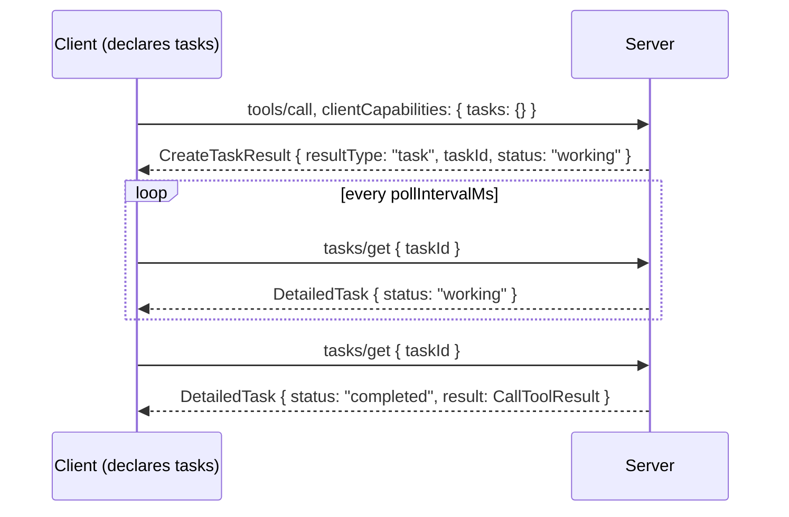
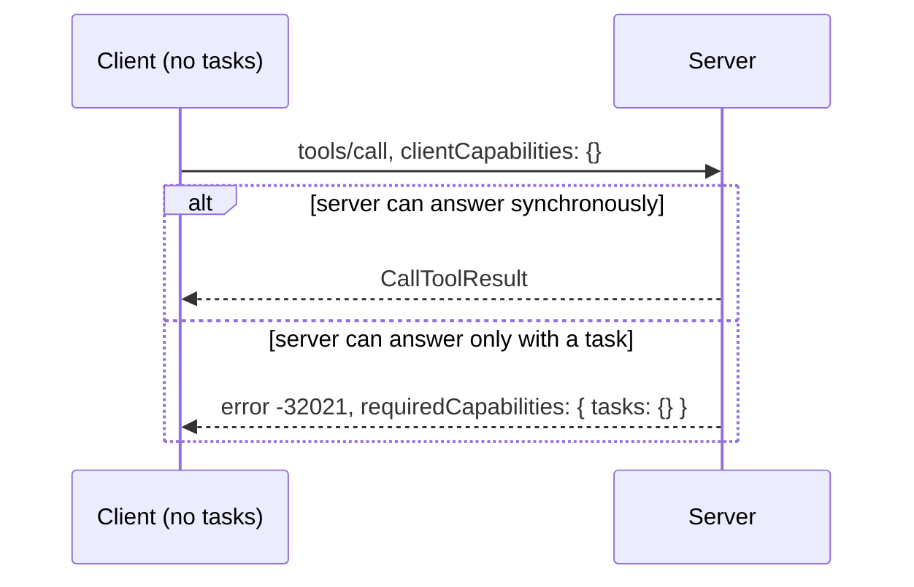
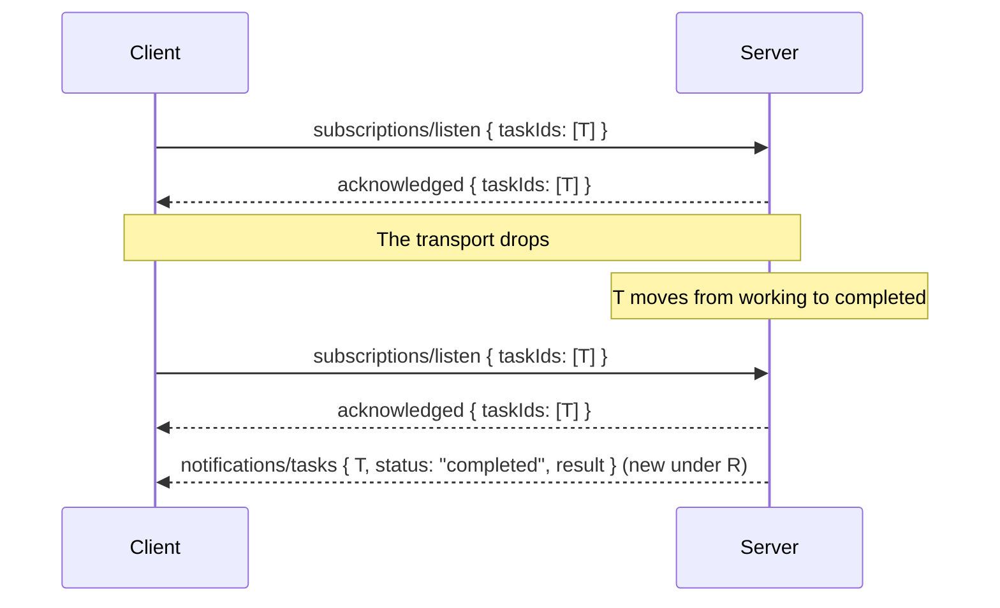
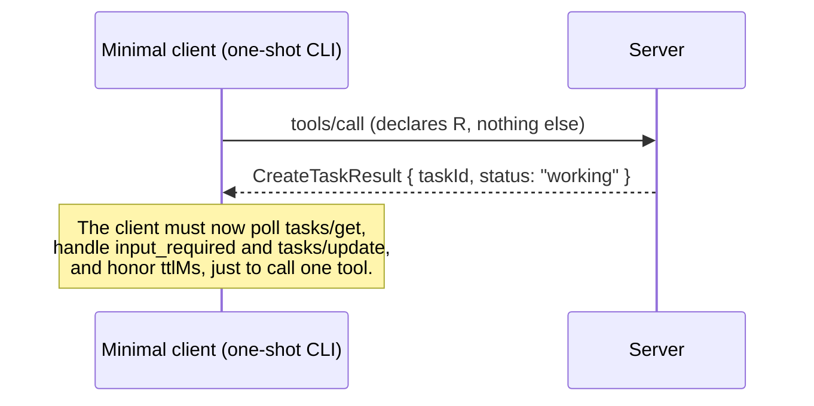

# SEP-3570: Promote Tasks into the Core Protocol

- **Status**: Draft
- **Type**: Standards Track
- **Created**: 2026-11-19
- **Author(s)**: Sri Panyam (@panyam)
- **Sponsor**: None
- **PR**: https://github.com/modelcontextprotocol/modelcontextprotocol/pull/3570

## Abstract

This SEP makes tasks part of the core protocol from a specific core protocol revision onward. [SEP-3392](./3392-extension-lifecycle.md) calls that revision R, and this SEP does the same. With tasks, a server can answer a `tools/call` request with a durable handle instead of a result. The client polls the handle with `tasks/get`. It answers mid-flight input with `tasks/update`, and it stops the work with `tasks/cancel`.

Core tasks is the Tasks extension (`io.modelcontextprotocol/tasks`, [SEP-2663](./2663-tasks-extension.md)) at revision `2026-07-28`, with the differences this SEP lists. The main difference is negotiation. A client declares a core `tasks` capability on each request, in place of the extension identifier. A request that declares a revision earlier than R keeps the extension's behavior, as SEP-3392 requires for a promoted extension.

## Motivation

The core protocol has no way to return a handle for work that outlives a request. Tasks fills that gap only as an extension, and three problems follow.

1. **Proposals that build on tasks rely on undefined behavior.** [SEP-2133](./2133-extensions.md) does not specify whether or how one extension may depend on another. A proposal that builds on the Tasks extension relies on that gap. With tasks in core, such a proposal builds on core.
2. **Every SDK carries tasks as a separate package.** > TODO: the packages (for example TypeScript `@modelcontextprotocol/ext-tasks`), and what an SDK user wires up today that core removes.
3. **Implementers cannot treat tasks as settled.** A Beta extension may change without a core protocol revision. A server that depends on long-running tools needs the stability that a core revision gives. > TODO: one concrete example.

Tasks is ready for core. SEP-2663 named core as the destination, and the extensions page lists Tasks as "Beta, to Core".

> TODO: adoption evidence. Clients that support tasks (client matrix, PRs #3355 and #3459). SDKs that implement the extension. Conformance results.

## Specification

### Source and target revision

The extension's source is [`modelcontextprotocol/ext-tasks`](https://github.com/modelcontextprotocol/ext-tasks), revision `2026-07-28`, at `specification/2026-07-28/`. Under SEP-3392 that directory moves to `specification/beta/tasks/2026-07-28/`.

**Target: the September 2027 release.** Under [SEP-3398](./3398-release-cycle-updates.md), MCP releases on the last Tuesday of March and of September. A release-bound SEP must be Final and merged by soft freeze, about 2.5 months before release. Final requires the reference implementation, the conformance scenario, and the interoperability run in Testing Plan.

| Release        | Expected date | Soft freeze, about | Fit                                                                                                                |
| -------------- | ------------- | ------------------ | ------------------------------------------------------------------------------------------------------------------ |
| March 2027     | 2027-03-30    | mid-January 2027   | Too early. Working Group approval, Core Maintainer review and the Final artifacts do not fit in about eight weeks. |
| September 2027 | 2027-09-28    | mid-July 2027      | Proposed. Its Core Maintainer review window opens about six months before release.                                 |

The published release calendar sets the exact dates, and R takes the date of that release. If this SEP misses the September 2027 soft freeze, it moves to the March 2028 release, and R moves with it.

The September 2027 release is also the first revision in which sampling and roots may be removed. They became eligible for removal in the first revision released on or after 2027-07-28 (SEP-2577). D5 ties task input requests to the core MRTR types, so core tasks follows whatever that release decides.

Core tasks is the extension's `2026-07-28` revision, with the differences listed below. A behavior this section does not list is unchanged from the extension. If ext-tasks publishes a later revision before this SEP reaches Final, this SEP moves to that revision and updates the differences.

### Differences from the extension

#### D1. Capability negotiation

Under the extension, the client declares `io.modelcontextprotocol/tasks` under `extensions` in each request's `io.modelcontextprotocol/clientCapabilities`. The server lists the same identifier under `extensions` in its `server/discover` result. Under R, tasks becomes a core capability named `tasks`. The client still opts in on each request. The rules are otherwise unchanged.

**Client.** A client that can handle a `CreateTaskResult` declares `tasks` in `io.modelcontextprotocol/clientCapabilities` on each request where it accepts one:

```json
{
  "jsonrpc": "2.0",
  "id": 1,
  "method": "tools/call",
  "params": {
    "name": "build_report",
    "arguments": { "quarter": "Q3" },
    "_meta": {
      "io.modelcontextprotocol/protocolVersion": "R",
      "io.modelcontextprotocol/clientCapabilities": {
        "tasks": {}
      }
    }
  }
}
```

**Server.** A server that can return tasks SHOULD advertise `tasks` in its `server/discover` result:

```json
{
  "capabilities": {
    "tools": {},
    "tasks": {}
  }
}
```

An empty object means support with no settings. Later revisions MAY define settings.

**Rules.**

- A server **MUST NOT** return a `CreateTaskResult` for a request that does not declare `tasks`.
- If the server can serve such a request only by creating a task, it **MUST** return `MissingRequiredClientCapabilityError` (`-32021`) with `data.requiredCapabilities` set to `{ "tasks": {} }`.
- A client that declares `tasks` **MUST** accept either the ordinary result or a `CreateTaskResult` for any task-augmented request.
- `tasks/get`, `tasks/update`, `tasks/cancel` and a `subscriptions/listen` request that names `taskIds` **MUST** declare `tasks`. A server **MUST** return `-32021` for one that does not. The extension has the same rule, under its Error Handling section.

The two diagrams show a declaring client and a non-declaring client.





#### D2. Relationship to the `2025-11-25` tasks feature

The `2025-11-25` revision defined an experimental feature named tasks. That feature advertised `capabilities.tasks` during `initialize`, with sub-keys such as `tasks.requests.tools.call`. It had a `task` request parameter, a blocking `tasks/result` and `tasks/list`. The `2026-07-28` revision removed it from core.

Core tasks under R reuses the name `tasks` for the capability key and the `tasks/` method prefix. It does not reuse the `2025-11-25` semantics. The negotiated protocol version decides which definition applies:

| Request declares | Capability location                                                  | Definition                             |
| ---------------- | -------------------------------------------------------------------- | -------------------------------------- |
| `2025-11-25`     | `capabilities.tasks` in `initialize`                                 | `2025-11-25` experimental tasks        |
| `2026-07-28`     | `extensions["io.modelcontextprotocol/tasks"]`                        | Tasks extension, revision `2026-07-28` |
| R or later       | `tasks` in per-request `clientCapabilities` and in `server/discover` | This SEP                               |

> TODO: SEP-2596 lifecycle wording for the `2025-11-25` feature, and a note in `deprecated.mdx` or the changelog.

#### D3. Reserved names and error codes

The extension reserves four names for itself, in its Reservations section. Under R, core defines or reserves each one, except the extension identifier.

| Name                                       | Extension (`2026-07-28`)   | Core under R                                                                                                    |
| ------------------------------------------ | -------------------------- | --------------------------------------------------------------------------------------------------------------- |
| `tasks/` method prefix                     | Reserved for the extension | Reserved for core. Only a core protocol revision adds a method under it.                                        |
| `notifications/tasks/` notification prefix | Reserved for the extension | Reserved for core, together with the exact method name `notifications/tasks`.                                   |
| `resultType` value `"task"`                | Reserved for the extension | Added to the core `ResultType` union.                                                                           |
| `io.modelcontextprotocol/tasks`            | The extension's identifier | Is still the extension's identifier, for requests that declare a revision earlier than R. Core does not use it. |

**`ResultType`.** The core union becomes `"complete" | "input_required" | "task" | string`. A server **MUST** set `resultType` to `"task"` on a `CreateTaskResult`. It **MUST NOT** set `"task"` on any other result. `tasks/get`, `tasks/update` and `tasks/cancel` return `resultType: "complete"`, as under the extension.

**`notifications/tasks`.** The extension reserves the prefix `notifications/tasks/`, with a trailing slash. Its one notification is named `notifications/tasks`, with no slash, so the prefix does not literally cover it. Core reserves both.

**`subscriptions/listen`.** The `taskIds` field of the `notifications` filter becomes a core field, in both the request and the `notifications/subscriptions/acknowledged` notification.

**Error codes.** Core tasks adds no error codes. It uses the same codes as the extension:

| Condition                                             | Code     | Requirement                                                                 |
| ----------------------------------------------------- | -------- | --------------------------------------------------------------------------- |
| Unknown or expired `taskId`                           | `-32602` | **MUST** for `tasks/get`. **SHOULD** for `tasks/update` and `tasks/cancel`. |
| Internal error                                        | `-32603` | As the extension.                                                           |
| Client did not declare `tasks` (see D1 for the cases) | `-32021` | **MUST**.                                                                   |

The only change is the `-32021` payload. `data.requiredCapabilities` reads `{ "tasks": {} }` instead of `{ "extensions": { "io.modelcontextprotocol/tasks": {} } }`.

**Routing headers.** The Streamable HTTP rule carries over unchanged. A client sending `tasks/get`, `tasks/update` or `tasks/cancel` **MUST** set `Mcp-Name` to `params.taskId`, and `Mcp-Method` to the method name.

#### D4. Task-augmented requests

Under R, `tools/call` is the only task-augmented request, as under the extension. A server **MUST NOT** return a `CreateTaskResult` for any other request. A client that receives one for another request **MUST** treat it as an invalid response.

Three rules carry over from the extension unchanged:

- **The server decides.** A client does not ask for a task on a request. A server that sees `tasks` declared returns a task or an ordinary result, per request, at its own discretion.
- **No per-tool flag.** The `2025-11-25` `execution.taskSupport` field on `Tool` is not part of core tasks. A client does not need `tools/list` before it calls a tool.
- **Tasks run on the server.** Server-to-client requests such as `elicitation/create` are never task-augmented. [SEP-2260](./2260-Require-Server-requests-to-be-associated-with-Client-requests.md) requires every server-to-client request to belong to a client request, so a client-hosted task has no valid way to be polled. A task that needs client input uses `inputRequests` (see D5).

A later core revision **MAY** add task-augmented requests. Implementations **SHOULD** be designed to accept more request types in later revisions. A client's obligations follow the revision it declares. A client that declares `tasks` under R handles tasks only for `tools/call`, even after a later revision adds another request.

#### D5. Input requests

Under R, a task's `inputRequests` and a client's `inputResponses` use the core `InputRequests` and `InputResponses` types of the revision the client declared. These are the same types [Multi Round-Trip Requests](/specification/draft/basic/patterns/mrtr) (MRTR) uses. The extension already points to MRTR for these types. Core tasks makes the link normative, and it adds no list of its own.

Today the core `InputRequest` union holds `elicitation/create`, `sampling/createMessage` and `roots/list`. SEP-2577 deprecated sampling and roots in `2026-07-28`, and the first revision released on or after 2027-07-28 may remove them. If R removes them from the union, a task under R cannot request them either. If R keeps them, they are still valid in a task, with the same Deprecated status they have in MRTR. Core tasks follows that decision and needs no change of its own.

Two rules apply to each entry in `inputRequests`:

- **Capability.** A server **MUST NOT** include a request that the client has not declared a capability for, as in MRTR. For example, a server **MUST NOT** include `elicitation/create` unless the client declared `elicitation`. The declarations that count are those on the request that created the task. The extension does not state this rule.
- **Trust model.** A client **MUST** treat each entry as it would the same request sent on its own. An elicitation inside a task gets the same trust model and user interface as a direct `elicitation/create`. This rule is unchanged from the extension.

The other `inputRequests` rules carry over unchanged. A key is unique over the task's lifetime and is never reused. A client answers with `tasks/update`, and partial answers are allowed. A server ignores answers for keys that are no longer outstanding.

As under the extension, tasks use neither logging nor progress. A server **MUST NOT** send `notifications/message` or `notifications/progress` on a task's subscription stream.

#### D6. Task state after a subscription starts

Under the extension, a client may rely on `notifications/tasks` alone and never poll. A subscription ends when its transport drops, and a server holds no subscription state across reconnections ([Subscriptions](/specification/draft/basic/patterns/subscriptions)). A transition during the gap has no stream to go to. If the task becomes terminal during the gap, it never changes again, so the client never hears about it. The client waits until `ttlMs` expires. If the task moved to `input_required`, the task also stalls, because the client never sees `inputRequests`. [ext-tasks#24](https://github.com/modelcontextprotocol/ext-tasks/issues/24) reports this gap.



Under R:

- After a server acknowledges a `subscriptions/listen` request that includes `taskIds`, it **MUST** send one `notifications/tasks` for each acknowledged task ID. Each notification carries the task's current `DetailedTask`.
- Task notifications are best-effort. `tasks/get` is the authoritative source of a task's state. A client that receives both a poll result and a notification **MAY** use `lastUpdatedAt` to discard the older one.

The same rule fits the extension, which is Beta and can still change. If ext-tasks adopts it before this SEP reaches Final, this difference disappears.

### Revisions earlier than R

For a request that declares a revision earlier than R, the extension applies as its final revision defines it. A client that still supports earlier revisions SHOULD keep advertising `io.modelcontextprotocol/tasks`. A server that does not yet support R can then fall back to the extension. A peer stops advertising the extension when it no longer supports any revision earlier than R.

### Specification and schema changes

When this SEP is accepted, the same pull request makes the changes below in the core draft. The extension's own files change later, when R is released.

**Schema (`schema/draft/schema.ts`).** The types come from the extension's `2026-07-28` schema. All of them exist in the extension today. Core tasks adds no new type. It moves the extension's types into core, folds two of them into existing core interfaces, and leaves one behind.

| Change               | Types                                                                                                                                                                                                                                                                                           |
| -------------------- | ----------------------------------------------------------------------------------------------------------------------------------------------------------------------------------------------------------------------------------------------------------------------------------------------- |
| Add task types       | `TaskStatus`, `Task`, `WorkingTask`, `InputRequiredTask`, `CompletedTask`, `FailedTask`, `CancelledTask`, `DetailedTask`, `CreateTaskResult`                                                                                                                                                    |
| Add task methods     | `GetTaskRequest`, `GetTaskResult`, `UpdateTaskRequest`, `UpdateTaskResult`, `CancelTaskRequest`, `CancelTaskResult`                                                                                                                                                                             |
| Add the notification | `TaskStatusNotification`, `TaskStatusNotificationParams`                                                                                                                                                                                                                                        |
| Extend unions        | `ResultType` gains `"task"` (D3). `ClientRequest` gains the three task requests. `ServerResult` gains their results and `CreateTaskResult`. `ServerNotification` gains `TaskStatusNotification`.                                                                                                |
| Extend capabilities  | `ClientCapabilities.tasks` and `ServerCapabilities.tasks`, each an empty object (D1)                                                                                                                                                                                                            |
| Fold in              | The extension adds `taskIds` through `TaskSubscriptionNotifications` and `TaskSubscriptionAcknowledgedNotifications`. In core, `taskIds` becomes a field of `SubscriptionFilter` and of the filter in `SubscriptionsAcknowledgedNotification`, and the two extension interfaces are not needed. |
| Not moved            | `TasksExtensionCapability`, the type of the extension's settings object. Core uses `ClientCapabilities.tasks` and `ServerCapabilities.tasks` instead (D1).                                                                                                                                      |

Each new type gets examples under `schema/draft/examples/<Type>/`. The `ServerCapabilities` example `extensions-tasks.json` is replaced with an example for another extension. Running `npm run generate:schema` regenerates `schema.json` and `schema.mdx`.

**Specification pages (`docs/specification/draft/`).**

| Page                                                             | Change                                                                                                                                                 |
| ---------------------------------------------------------------- | ------------------------------------------------------------------------------------------------------------------------------------------------------ |
| `basic/patterns/tasks.mdx` (new)                                 | The core tasks specification: the extension's text with D1 to D6 applied, plus the Security Implications rules. It sits beside MRTR and subscriptions. |
| `server/tools.mdx`                                               | `tools/call` may return a `CreateTaskResult` to a client that declares `tasks` (D4).                                                                   |
| `basic/patterns/subscriptions.mdx`                               | The `taskIds` filter field, the snapshot rule (D6) and the authorization rule for subscribed task IDs.                                                 |
| `basic/patterns/mrtr.mdx`                                        | A note that task `inputRequests` use the same types and the same capability rule (D5).                                                                 |
| `basic/patterns/cancellation.mdx`, `basic/patterns/progress.mdx` | A note that tasks use `tasks/cancel`, not `notifications/cancelled`, and carry no progress notifications.                                              |
| `basic/transports/streamable-http.mdx`                           | The `Mcp-Name` row lists `tasks/get`, `tasks/update` and `tasks/cancel`, with `params.taskId` as the source.                                           |
| `basic/versioning.mdx`                                           | The extension example uses another extension in place of Tasks.                                                                                        |
| `index.mdx`                                                      | The Tasks entry points to the core page, not the extension.                                                                                            |
| `changelog.mdx`                                                  | An entry for this SEP.                                                                                                                                 |
| `docs/docs.json`                                                 | The new page goes in the Patterns group.                                                                                                               |

**Other documentation.** The extension overview at `docs/extensions/tasks/overview.mdx` gains a note that R and later define tasks in core. Three draft guides mention the extension: `docs/docs/draft/learn/architecture.mdx`, and `protocol-eras.mdx` and `web.mdx` under `docs/docs/draft/tools/inspector/`. Each is updated to match.

**When R is released.** These changes happen outside this SEP's pull request:

- ext-tasks moves its specification to `specification/archived/tasks`, with a notice that points to the core page and this SEP (SEP-3392).
- The extensions page lists Tasks as promoted to core.
- The conformance scenario changes its tag from the draft version to R (SEP-2484).

## Rationale

### Why promote now

SEP-2663 set the bar for promotion: "Once the extension has stabilized and achieved broad adoption, it is intended to be promoted into the core protocol." This section takes each half in turn.

**The extension has stabilized.**

- ext-tasks locked its `2026-07-28` revision on 2026-08-24. Since then its specification has had one change, which corrected the `resultType` in an example ([ext-tasks#25](https://github.com/modelcontextprotocol/ext-tasks/pull/25)). Its `draft` differs from `2026-07-28` only in two links.
- SEP-2663 moved tasks out of core to fix four problems. These were a fragile handshake, a blocking `tasks/result`, `tasks/list` scoping that could not be defined, and client-hosted tasks that SEP-2260 made invalid. The `2026-07-28` revision fixes all four. It has needed no breaking change since.
- The Tasks and Events Working Group charter lists promotion to core as a success criterion. The extensions page lists Tasks as "Beta, to Core".

**Adoption is the weaker half.** The [client matrix](/extensions/client-matrix) lists Tasks support in 4 of 17 clients: Claude (web), Claude Code, MCPJam and Glean.

> TODO: server-side and SDK adoption, from the Working Group.

**The case for waiting.** Four of 17 clients is not broad adoption. Another release cycle in Beta would gather more evidence while the extension can still change without a core revision.

**Why this SEP does not wait.**

- Core tasks differs from the extension only in D1 to D6. An implementer's work on the extension carries over to core.
- This SEP reaches Final only with a reference implementation and a conformance scenario (SEP-2484). Under [SEP-3398](./3398-release-cycle-updates.md), it must do so by the soft freeze of R's release. Beta evidence keeps arriving until then.
- The Working Group should still judge, at soft freeze, whether the adoption evidence is enough. If it is not, this SEP moves to the next release, and R moves with it.

### Why promote from Beta, not Stable first

**Alternative.** Move the extension to Stable with a second Extensions Track SEP, then promote it to core with a later Standards Track SEP.

**The case for it.** Under SEP-3392, entry to Stable requires two independent implementations that interoperate, one client-side and one server-side, plus a conformance scenario. That evidence would exist before core commits to the design. Stable also fixes behavior within each core revision, so implementers would get stability sooner.

**Why this SEP does not adopt it.**

- SEP-3392 allows promotion from Beta, and the extension's stated destination is Core.
- Going through Stable means two SEPs and two review cycles to reach the same place. While Stable, the extension could change only with a new core revision, so D1 to D6 would wait for a core revision either way.
- This SEP meets the Stable evidence bar itself. Before Final, it shows two independent, interoperating implementations, one client-side and one server-side, and a SEP-2484 conformance scenario. So the SEP skips the Stable stage but still meets the Stable evidence bar.

**Can it come back later?** Yes. If the Working Group judges the evidence too thin, the extension can go to Stable first. SEP-3392 also allows promotion from Stable, so this SEP can return from there.

### Decisions in the Specification

Each decision below names the alternative, the case for it, and why this SEP does not adopt it. It also says whether a later revision can still adopt it. Four of the six decisions can be relaxed later without breaking an R implementation. D2 cannot. D6 can be extended later but not relaxed.

| Decision                    | Proposed                                       | Alternative                                        | Can a later revision adopt the alternative?                |
| --------------------------- | ---------------------------------------------- | -------------------------------------------------- | ---------------------------------------------------------- |
| D1. Capability negotiation  | Client opts in per request                     | Mandatory for every R client                       | Yes                                                        |
| D2. Capability name         | Reuse `tasks`                                  | A fresh key                                        | No. A rename breaks R implementations.                     |
| D3. `tasks/` prefix         | Reserved for core                              | Open to extensions                                 | Yes                                                        |
| D4. Task-augmented requests | `tools/call` only                              | Add `resources/read` and others                    | Yes                                                        |
| D5. Input request types     | The core MRTR types of the declared revision   | A list owned by tasks                              | Yes                                                        |
| D6. State after subscribing | Server **MUST** send each task's current state | Client **MUST** call `tasks/get` after subscribing | Adding the client rule: yes. Relaxing the server rule: no. |

#### D1: keep the client opt-in

**Alternative.** Make tasks mandatory. Every client that declares R must accept a `CreateTaskResult` for any task-augmented request. Clients do not declare tasks, and servers do not check.

**The case for it.** A server author could rely on tasks with every R client. A long-running tool would need one code path, not a task path plus a synchronous or `-32021` fallback. Tasks would also become the single way to run long work, instead of an optional mode.

**Why this SEP does not adopt it.** Every client would have to implement tasks, including clients that never call a long-running tool:



|                           | (a) Opt-in, as a core capability (proposed)                                                 | (b) Mandatory for R clients                                             |
| ------------------------- | ------------------------------------------------------------------------------------------- | ----------------------------------------------------------------------- |
| Minimal clients           | Unchanged. They omit `tasks` and get ordinary results or `-32021`.                          | Every R client must implement polling, `tasks/update` and cancellation. |
| Server logic              | Checks one declaration per request. The extension already does this.                        | Never checks.                                                           |
| Change from the extension | Moves the key out of `extensions`. Rules and errors do not change.                          | Adds a new conformance requirement for every client.                    |
| Consistency with core     | Matches elicitation and other client features under SEP-2575, which `-32021` already gates. | Tasks would be the only client-side feature without a declaration.      |
| Partial adoption          | A client can declare tasks on some requests and not others.                                 | Not possible.                                                           |

**Can it come back later?** Yes. A later revision can make tasks mandatory once most clients declare it. Servers lose nothing in that change: they stop checking the declaration. The reverse move would break servers that rely on every client handling tasks. Starting with opt-in leaves both options available.

#### D2: reuse the `tasks` name

**Alternative.** Choose a fresh capability key, so the `2025-11-25` key never gets a second meaning.

**The case for it.** An SDK that supports both `2025-11-25` and R must check the protocol version before it parses a `tasks` key. A fresh key removes that check. It also keeps search results, logs and documentation from mixing up two features with one name.

**Why this SEP does not adopt it.**

- No current core revision defines `tasks`. The `2026-07-28` revision removed it.
- The two keys never share a location. The `2025-11-25` key appears only in `initialize`. The R key appears only in per-request `clientCapabilities` and in `server/discover`. A `2025-11-25` server does not read either R location.
- SEP-2663 already reused `tasks/get` and `tasks/cancel` with new shapes. The protocol version tells them apart.
- A fresh key would leave the capability out of step with its methods, its notification and its documentation, which all say "tasks".

**Can it come back later?** No. Renaming a core capability after R breaks every implementation of R. The Working Group should treat this decision as final, because no other decision in this SEP is as hard to undo.

#### D3: reserve the `tasks/` prefix for core

**Alternative.** Core defines `tasks/get`, `tasks/update`, `tasks/cancel` and `notifications/tasks`, and leaves the rest of the `tasks/` prefix open to extensions.

**The case for it.** A proposal that adds a task method could then ship as an extension. It would iterate under Extension Maintainer approval, on the SEP-3392 Beta path, instead of waiting for a core release. SEP-2694 proposes `tasks/stream`, and it could take that path.

**Why this SEP does not adopt it.** With an open prefix, two extensions could define the same `tasks/` method with different meanings. A later core method could also collide with an extension method. Under the extension today, the prefix is already reserved, so reserving it in core changes nothing for current proposals.

**Can it come back later?** Yes. A later revision can release part of the prefix. That only allows more names, so it breaks nothing. The reverse move would break any extension that already uses a `tasks/` name. Open Question 3 asks the Working Group whether it wants this effect.

#### D4: keep `tools/call` as the only task-augmented request

**Alternative.** Add requests at promotion time, such as `resources/read` and `prompts/get`.

**The case for it.** A resource that the server generates on demand, such as a rendered report, can take as long as a tool call. Without tasks, a server has two choices for such a read. It can hold the request open, or it can expose the work as a tool instead. A task-augmented `resources/read` would give that read the same durable handle that a tool call gets.

**Why this SEP does not adopt it.**

- **Beta tested only `tools/call`.** Under SEP-3392, Beta exists to collect real usage before the design is fixed. No Beta implementation has returned a task for any other request. Promotion should bring only tested behavior into core.
- **Each added request is more work for every client.** A client that declares `tasks` **MUST** accept a `CreateTaskResult` for every task-augmented request. Adding `resources/read` would make every such client poll for resource reads too.

**Can it come back later?** Yes. Client obligations follow the declared revision, so a later revision can add a request without breaking a client that declares R. That change needs a core SEP with evidence from implementations. Open Question 4 asks for that evidence.

#### D5: use the core MRTR types for input requests

**Alternative.** Tasks owns its own list of allowed input requests. One version allows only `elicitation/create`, and leaves out the deprecated sampling and roots from the start.

**The case for it.** No new implementation would build sampling or roots into tasks, since both are on their way out. A task-only list could also differ from MRTR where tasks need it to, for example to allow a request that makes sense only during long-running work.

**Why this SEP does not adopt it.** A separate list would put two definitions of server-to-client input in core, and both would need to change for every later revision. With one list, a server can run the same elicitation code for an MRTR retry and for a task. A deprecation or removal also applies to both mechanisms at once, under the SEP-2596 lifecycle, with no extra SEP for tasks.

**Can it come back later?** Yes. A later revision can give tasks its own list, if tasks needs a request that MRTR does not. Client obligations follow the declared revision, so an R client is not affected.

#### D6: the server sends current state after a subscription starts

**Alternative.** Put the duty on the client. A client that starts or restarts a subscription **MUST** call `tasks/get` once for each acknowledged task ID before it relies on notifications. ext-tasks#24 offers this option alongside the server rule.

**The case for it.** It needs no server change, and it works with every server that implements the extension today.

**Why this SEP does not adopt it.** It protects only clients that follow it. A client that skips the call still waits until `ttlMs` expires. The server rule adds one notification per acknowledged task, and it protects every client. A server-side implementer in ext-tasks#24 also prefers it. With the snapshot, a server needs no replay log and no record of which notifications were delivered. The next subscription repairs any missed transition.

**Why MUST and not SHOULD.** ext-tasks#24 proposes SHOULD. With SHOULD, a client cannot rely on the snapshot, so it would still need the client rule. MUST lets a client drop polling safely.

**Can it come back later?** In part. A later revision can add the client rule on top, and that breaks nothing. It cannot relax the server MUST to SHOULD, because R clients may rely on the snapshot.

## Backward Compatibility

Requests that declare a revision earlier than R see no change. A request that declares `2026-07-28` keeps the extension's behavior. A request that declares `2025-11-25` keeps the `2025-11-25` tasks feature (see D2).

### What changes under R

An implementation that moves from the extension to core tasks makes one mechanical change and meets two new rules. Methods, task shapes, statuses, `resultType` values, error codes and routing headers do not change.

| Change                                                                                     | Who     | Kind                      | Section |
| ------------------------------------------------------------------------------------------ | ------- | ------------------------- | ------- |
| Declare `tasks` in `clientCapabilities`, not `extensions["io.modelcontextprotocol/tasks"]` | Clients | Mechanical: the key moves | D1      |
| Advertise `tasks` in `server/discover`, and send `{ "tasks": {} }` in `-32021`             | Servers | Mechanical: the key moves | D1, D3  |
| Include an input request only if the client declared its capability                        | Servers | New rule                  | D5      |
| Send each task's current state after acknowledging `subscriptions/listen` with `taskIds`   | Servers | New rule                  | D6      |

The D6 rule adds notifications that a client did not receive before. Each one carries a complete `DetailedTask`, the same content a `tasks/get` returns, so a client can apply it as it applies any task notification.

**The extension identifier in an R request.** In a request that declares R, only `tasks` declares task support. A server **MUST** ignore `extensions["io.modelcontextprotocol/tasks"]` in such a request. A client that sends only the extension identifier with R therefore gets ordinary results, or `-32021` naming `tasks`, and the error tells it what to add. Open Question 7 asks whether a server should accept the identifier instead.

### Mixed peers

The protocol version is chosen per request, so each request uses one definition. A client that supports both R and `2026-07-28` declares `tasks` in requests that declare R, and the extension identifier in requests that declare `2026-07-28`. Version mismatches follow the core [compatibility rules](/specification/draft/basic/versioning).

| Client supports    | Server supports    | Outcome                                                                                                                  |
| ------------------ | ------------------ | ------------------------------------------------------------------------------------------------------------------------ |
| R and `2026-07-28` | R                  | Requests declare R and use core tasks.                                                                                   |
| R and `2026-07-28` | `2026-07-28` only  | The server returns `UnsupportedProtocolVersionError`. The client retries with `2026-07-28` and the extension identifier. |
| `2026-07-28` only  | R and `2026-07-28` | Requests declare `2026-07-28`. The server applies the extension.                                                         |
| R only             | `2026-07-28` only  | No common version. This fails like any version mismatch.                                                                 |

A server that supports both R and `2026-07-28` serves both definitions. It reads the declared version, then checks the matching declaration.

### Migration for SDKs

An SDK that ships tasks as a separate extension package, such as `@modelcontextprotocol/ext-tasks`, moves the R path into its core package. The extension package then serves only requests that declare a revision earlier than R. An implementation drops the extension path when it no longer supports any revision earlier than R. SEP-3392 sets no other sunset date.

### Severity

Low. Nothing changes for an implementation until it adopts R. Adopting R means one key move on each side, plus the two server rules in D5 and D6.

## Security Implications

Core tasks keeps the extension's security model. Its four rules carry over unchanged:

- **Task IDs are unguessable.** A server **MAY** use a task ID as a bearer token for its stored state. It **MUST** generate task IDs with enough entropy that a third party cannot enumerate or guess them.
- **Every task request is authorized.** A server **MUST** authenticate and authorize each task-related request, so that a client reaches only tasks it may access.
- **No cross-caller listing.** Core tasks has no `tasks/list`, so a server cannot leak one caller's task IDs to another.
- **A task is not a higher-trust channel.** A host **MUST** apply the same trust model to an entry in `inputRequests` as to the same request sent on its own.

The differences in this SEP change the model in two places.

**D6 makes subscription authorization explicit.** Under D6, a server answers each acknowledged task ID with the task's full current state, including its `result` or `error`. A subscription is therefore a way to read a task, just like `tasks/get`. The extension's rule covers "each task-related request", but it does not name `subscriptions/listen`. Core tasks names it:

- A server **MUST** apply the same authorization check to each task ID in a `subscriptions/listen` request as it applies to `tasks/get` for that ID.
- A server **MUST NOT** acknowledge a task ID that fails the check, and it **MUST NOT** send a notification for that ID. The acknowledgement lists only the IDs the server accepted, so an unauthorized ID looks the same as an unknown one.

A subscription can name many task IDs, and D6 sends one notification for each. A server **MAY** limit how many task IDs it acknowledges in one subscription. A client learns the accepted set from the acknowledgement.

**D5 narrows what a server can ask for.** A server can no longer include an input request for a capability the client did not declare on the request that created the task. This removes a path by which a task could send an elicitation to a client that never offered to show one.

D1 to D4 move names and keys, and they do not change the security model.

## Reference Implementation

> TODO: an SDK branch that serves tasks as core behavior under revision R.

## Testing Plan

This SEP changes observable protocol behavior, so [SEP-2484](./2484-conformance-tests-required-for-final-seps.md) applies. Before Final, the [conformance repository](https://github.com/modelcontextprotocol/conformance) needs three things:

1. A scenario tagged with this SEP's number, targeting the draft spec version for R.
2. A traceability file, `sep-3570.yaml`, with a row for every **MUST**, **MUST NOT**, **SHOULD** and **SHOULD NOT** in this SEP's Specification section.
3. A passing run of the scenario against the reference implementation.

### Starting point

The conformance repository already tests the extension. `src/scenarios/server/tasks/` holds 13 scenario files, and `src/seps/sep-2663.yaml` maps 52 requirements: 40 to checks and 12 to documented exclusions.

Core tasks keeps most of those requirements. This plan reuses the existing checks and adds checks only for the differences.

- **Carried-over rules.** The existing scenarios run a second time with requests that declare R and `tasks`. Each carried-over requirement in `sep-3570.yaml` points to the same check ID as in `sep-2663.yaml`.
- **Carried-over exclusions.** The 12 exclusions keep their reasons. Examples are task ID entropy, host trust models and client polling cadence, which are not observable on the wire.
- **Earlier revisions.** The existing scenarios keep running with `2026-07-28` and the extension identifier. A pass shows that requests before R behave as before.

### New checks

| Section                | Check                                                                                                                      | Side   |
| ---------------------- | -------------------------------------------------------------------------------------------------------------------------- | ------ |
| D1                     | A request that declares R without `tasks` gets an ordinary result or `-32021`, never a `CreateTaskResult`.                 | Server |
| D1                     | `-32021` carries `requiredCapabilities: { "tasks": {} }`.                                                                  | Server |
| D1                     | `tasks/get`, `tasks/update` and `tasks/cancel` without `tasks` return `-32021`.                                            | Server |
| D1                     | `server/discover` lists `tasks` in `capabilities`. A SHOULD, so it reports as a warning.                                   | Server |
| D4                     | A request other than `tools/call`, with `tasks` declared, never gets a `CreateTaskResult`.                                 | Server |
| D4                     | A client treats a `CreateTaskResult` for another request as an invalid response.                                           | Client |
| D5                     | A task created without `elicitation` declared never lists `elicitation/create` in `inputRequests`.                         | Server |
| D6                     | After acknowledging `subscriptions/listen` with `taskIds`, the server sends one `notifications/tasks` per acknowledged ID. | Server |
| D6                     | A task that completes while no subscription is open is reported as `completed` after the client subscribes again.          | Server |
| Backward Compatibility | A request that declares R and carries only the extension identifier is treated as not declaring `tasks`.                   | Server |
| Security Implications  | `subscriptions/listen` with an unknown task ID does not acknowledge it and sends no notification for it.                   | Server |

### Expected exclusions and gaps

- **Authorization across callers.** The rule that a subscription gets the same authorization check as `tasks/get` needs two authenticated callers. `sep-2663.yaml` excludes the matching extension rule because it depends on the auth scheme. This SEP inherits that exclusion, unless the framework can run two callers by then. The unknown-ID check above covers the observable part.
- **Test fixtures.** The D5 and D6 checks need fixture tools on the server under test: one that needs input, and one whose task completes at a time the scenario controls. If the existing fixtures cannot do this, the scenario adds them.
- **Version negotiation.** SEP-2484 requires the harness and the server under test to accept the draft version tag. The mixed-peer cases in Backward Compatibility rely on the core version-negotiation scenarios, not on new task checks.

### Interoperability

Rationale commits this SEP to the Stable evidence bar of SEP-3392. Before Final, a client and a server from two independent implementations complete a task over R. The run covers creation, `input_required` with `tasks/update`, completion, cancellation, and a subscription with its D6 snapshot.

> TODO: name the two implementations, and link the scenario and the run results once they exist.

## Relationship to Other Proposals

This section is informative. It adds no requirements.

Core tasks gives other proposals a stable set of names to build on:

- `taskId`, which identifies a task across requests, notifications and other features.
- `Task` and `DetailedTask`, the task's state and its final result or error.
- `notifications/tasks`, and the `taskIds` field of the `subscriptions/listen` filter.
- The `resultType` union, which is still open to later values.
- `inputRequests` and `inputResponses`, which use the core MRTR types (D5).

A proposal that builds on these names depends on core. Core tasks depends on none of the proposals below.

### MCP Apps

[MCP Apps](https://github.com/modelcontextprotocol/ext-apps) is a Stable extension. Its draft specification, under "Long-Running App Tools", says an app's `tools/call` "MAY be task-augmented per core MCP Tasks". Hosts proxy `tasks/*` to the app as they proxy `tools/call`. The link points to the `2025-11-25` tasks page, and the `2026-07-28` revision removed that feature from core.

With this SEP, the reference has a valid core target again. Under SEP-3392, a Stable extension changes only with a new core revision, so the ext-apps revision keyed to R can link to core tasks. The proxying model needs no change.

### Events

[Events](./3415-events-extension.md) (SEP-3415) is an accepted extension. It delivers events on its own `events/stream`, not on `subscriptions/listen`. Its Open Question 4 asks whether task state changes should also be an `mcp.task.updated` event. That event would let a client that disconnected learn about completion by poll or webhook. Separately, [ext-tasks#38](https://github.com/modelcontextprotocol/ext-tasks/pull/38) proposes task output views built on Events, bound to a task through `eventSource`.

Both ideas refer to a task by its `taskId`, so they depend on core tasks and not the reverse. D6 covers a client that comes back and subscribes again. Delivery to a client that does not come back, for example by webhook, remains a question for Events.

### Authorization

Core tasks keeps the extension's rule that every task request is authorized, and Security Implications adds subscriptions to it. The [authorization specification](/specification/draft/basic/authorization) and the [ext-auth](https://github.com/modelcontextprotocol/ext-auth) extensions do not mention tasks.

A task can outlive the access token that created it. A client may poll with a refreshed token, or with a token from another grant, for the same principal. Neither the extension nor this SEP says whether the server's check binds a task to the principal or to the token. Open Question 8 asks this.

### Agents

The Tasks and Events Working Group charter says that agent-as-tool, remote-agent and supervisor patterns depend on tasks. The Agents Interest Group is scoping [intermediary results](https://github.com/modelcontextprotocol/agents-wg/issues/26) and [steering](https://github.com/modelcontextprotocol/agents-wg/issues/27). [ext-tasks#26](https://github.com/modelcontextprotocol/ext-tasks/pull/26) came out of the steering work. These are users of tasks. This SEP does not include them, and Open Question 5 defers ext-tasks#26.

### Progressive disclosure

The Progressive Disclosure Working Group is drafting a SEP that groups primitives ([progressive-disclosure-wg#19](https://github.com/modelcontextprotocol/progressive-disclosure-wg/pull/19)). A tool in a group is still called with `tools/call`, so a grouped tool can still return a task.

> TODO: confirm against the draft text.

### Other proposals

- [SEP-2848](https://github.com/modelcontextprotocol/modelcontextprotocol/pull/2848), asynchronous approval for tool calls, returns a task handle while an approval resolves. It is a draft extension, and it would depend on core tasks.
- [SEP-2694](https://github.com/modelcontextprotocol/modelcontextprotocol/pull/2694), resumable task event streams, proposes `tasks/stream`. With the `tasks/` prefix reserved for core (D3), it would need a core SEP or a name outside `tasks/`. Open Question 3 asks about this.
- [SEP-3371](https://github.com/modelcontextprotocol/modelcontextprotocol/pull/3371), SDK extension points, defines how SDKs host extensions in separate packages. Under R, tasks moves out of an extension package and into the SDK core. The extension package remains for revisions earlier than R (see Backward Compatibility).
- [MRTR](/specification/draft/basic/patterns/mrtr) and [subscriptions](/specification/draft/basic/patterns/subscriptions) are core patterns that tasks builds on. This SEP changes neither, apart from adding the `taskIds` filter field to subscriptions.

## Open Questions

1. **Capability negotiation.** Proposed in D1: the client opts in per request with a core `tasks` capability. Open for WG review.
2. **The `2025-11-25` tasks feature.** Proposed in D2: reuse the `tasks` name. Still open: the SEP-2596 lifecycle wording for the `2025-11-25` feature.
3. **Reserved names.** Proposed in D3: core reserves the `tasks/` prefix. Open: with that reservation, a proposal that adds a task method must be a core SEP. SEP-2694 proposes `tasks/stream` as an extension, so it would need a core SEP or a method outside `tasks/`. Is that the intended effect?
4. **Scope.** Proposed in D4: `tools/call` is still the only task-augmented request. Open: does any implementer have evidence for another request, such as `resources/read`?
5. **Open extension semantics.** Three open ext-tasks threads touch task semantics:
   - [ext-tasks#24](https://github.com/modelcontextprotocol/ext-tasks/issues/24), transitions missed across a reconnect. Settled in D6. Open: should the rule go to ext-tasks first, so that it is not a difference at all?
   - [ext-tasks#37](https://github.com/modelcontextprotocol/ext-tasks/issues/37), terminal status vs accepted work. Out of scope. It asks about an application profile and changes no protocol behavior. Core tasks keeps the extension's meaning: `completed` means the request finished, and a tool result with `isError: true` is still `completed`.
   - [ext-tasks#26](https://github.com/modelcontextprotocol/ext-tasks/pull/26), a `relatedTaskIds` key in `_meta`. Deferred. It is an open proposal that no Beta implementation has tested. If ext-tasks merges it before this SEP reaches Final, this SEP moves to that revision and carries it. Otherwise it needs a later core SEP.
6. **Input requests and deprecated features.** Proposed in D5: a task's input requests use the core MRTR types of the declared revision, so sampling and roots in tasks follow the SEP-2577 timeline. Open: should the capability check use the declarations on the request that created the task, as D5 proposes, or the declarations on each `tasks/get`?
7. **The extension identifier in an R request.** Proposed in Backward Compatibility: a server ignores `extensions["io.modelcontextprotocol/tasks"]` in a request that declares R. The alternative treats it as a declaration of `tasks`. That would forgive a client that updates its version but not its declaration, but core would then have two ways to say the same thing. Which should core choose?
8. **Task authorization across tokens.** A task can outlive the access token that created it. Should the server bind a task to the authenticated principal, so that a refreshed token can still read it, or to the token itself? See Relationship to Other Proposals, Authorization.

## Acknowledgments

This SEP builds on SEP-1686 and SEP-2663, by Luca Chang (@LucaButBoring) and Caitie McCaffrey (@CaitieM20).
